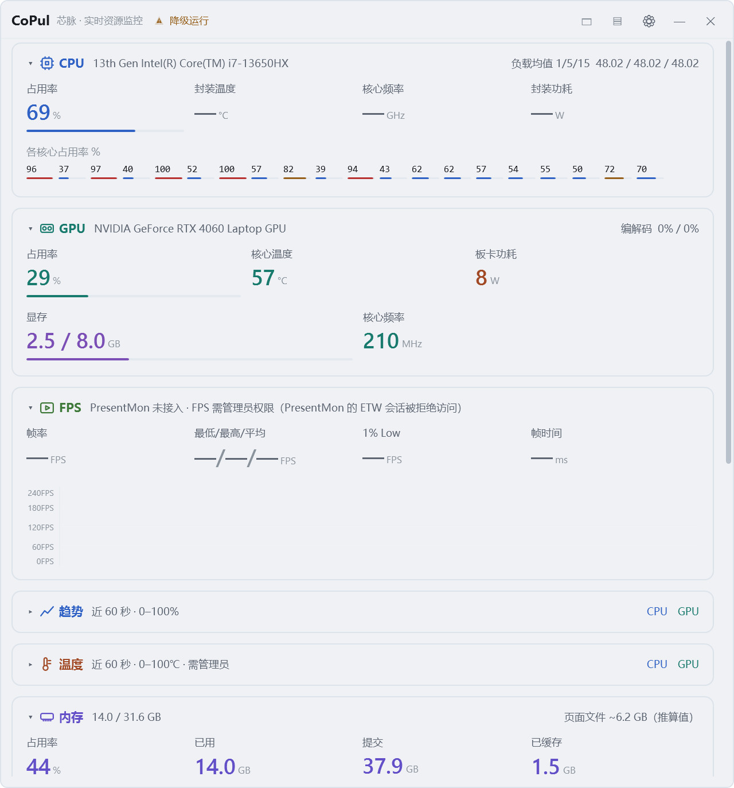

# CoPul 芯脉

> 把 CPU、GPU、内存、硬盘、网络、帧率贴在 Windows 任务栏上。三种视图、点击穿透、全屏游戏自动让路。

<sub>v0.1.0 · 尚未公开发布（仓库暂时私有） · 专有软件，保留所有权利（见 <a href="#许可">许可</a>）</sub>



---

## 这是什么

CoPul 是一个**常驻托盘**的实时硬件监控小工具。它不弹大窗口打扰你，而是把最关心的几个数字塞到你本来就在看的地方 —— 任务栏那段空白、屏幕角落的一条、或者需要时再打开的大窗口。

三个视图共用同一份采集与配置，可以同时开着，也可以随时全部收起。

| 视图 | 形态 | 适合 |
| --- | --- | --- |
| **任务栏条** | 贴在任务栏空白区的一条，默认点击穿透 | 一直看得见，又不占地方 |
| **悬浮窗** | 可拖动、可吸附边缘的窄条，可横排可竖排 | 全屏游戏 / 全屏视频时看 |
| **大窗口** | 卡片式面板：占用、趋势、温度、内存、硬盘、网络、进程 | 想看清楚的时候 |


<br>


## 指标

九项，按需勾选（只剩一项时禁止再关，免得条子缩成一条线）：

`FPS` · `CPU` · `GPU` · `内存` · `显存` · `硬盘温度` · `上传 / 下载` · `网络延迟` · `整机功耗`

大窗口在此基础上还提供：每个核心的占用网格、60 秒趋势曲线（CPU / GPU / 温度）、内存与页面文件明细、硬盘读写与温度、网卡速率、进程表。

## 快速上手

0. **首次启动会先弹许可协议**：条款全文可滚动，勾选「我已阅读并同意上述全部条款」后
   「同意并继续」才可点。不同意就退出，程序不会采集任何数据。同意结果（版本 + 时间）
   记在配置文件里，之后不再询问 —— 协议改版时会重新问一次。
1. **手动启动会直接打开大窗口**；开机自启则是直接以任务栏条出现。
   点窗口右上角 `×` 只是隐藏，程序仍在托盘里跑（要真退出用托盘菜单 →「退出」）。
2. **右键托盘图标** → 勾「大窗口 / 悬浮窗 / 任务栏条」，想显示哪个点哪个，三个可以同时开。
   托盘图标可能被折叠在任务栏的 `^` 里，拖出来更顺手。
3. 任务栏条默认**点击穿透**（点它等于点到底下的任务栏），所以条上没有右键菜单 —— 所有操作都在托盘。
   - 想临时点它，托盘菜单 →「任务栏条可点击」。
4. **`Ctrl + Alt + C`**：全部隐藏 ↔ 恢复上次的组合。
5. 设置页：托盘菜单 →「设置…」。外观、视图、字段、逐字段配色、采集间隔、开机自启都在那里。
6. 进全屏游戏时，任务栏条自动收起、悬浮窗自动顶上；退出全屏自动还原。

## 系统要求

- Windows 10 1809 及以上 / Windows 11，**x64**
- 以自包含方式发布时不需要预装 .NET 运行时
- 显存、GPU 型号等依赖厂商驱动正常安装

> 开发与验证只在 Windows 11 + Intel 13 代 + RTX 4060 上做过，Windows 10 与其他硬件欢迎反馈问题。

## 权限说明（重要，别看漏）

CoPul 默认**不提权**，以下功能在普通权限下会显示 `—`，属于预期降级，不是 bug：

| 功能 | 需要 | 原因 |
| --- | --- | --- |
| CPU 温度 / 整机功耗 / 硬盘温度 | 管理员 + [PawnIO](https://pawnio.eu/) 驱动 | 直读 MSR / NVMe SMART 必须进内核态 |
| FPS | 管理员 | PresentMon 的 ETW 会话要有权限 |

**PawnIO 不随本程序分发**，需要自行安装。装好后以管理员身份运行 CoPul 才会出现温度。设置页 →「传感器诊断」会列出每个采集器的实际状态和补救建议。

## 隐私

- 所有数据都是**本机采集**，不上传、不联网、不含任何统计或遥测。
- 配置只写 `%APPDATA%\CoPul\config.json`，崩溃日志写到 `%LocalAppData%\CoPul\`。
- 唯一的外部程序是随包的 `PresentMon.exe`（Intel 的 MIT 许可工具），只用来读帧率。

## 配置与相关文件

| 内容 | 位置 |
| --- | --- |
| 配置 | `%APPDATA%\CoPul\config.json` |
| 崩溃日志 | `%LocalAppData%\CoPul\crash-*.log` |
| 开机自启 | 计划任务 `CoPul`（不是 Run 注册表项，因为需要提权启动） |
| 许可协议 | 随包的 `LICENSE.txt`；同意状态记在 `config.json` 的 `LicenseAcceptedVersion` / `LicenseAcceptedAt` |

想恢复默认：退出程序后删掉 `config.json` 即可，下次启动会重新播种。

## 已知限制

- **任务栏条**附着在系统任务栏的空白区，依赖 `Shell_TrayWnd` 的结构。第三方任务栏 / 开始菜单工具（StartAllBack、ExplorerPatcher 等）未做适配，可能错位。
- **独占全屏的游戏**里，任何覆盖层都上不了屏（DWM 独立翻转），这是系统行为。CoPul 的做法是全屏时自动让路，不是"修好了"。
- **反作弊**：覆盖层在技术上可能被个别反作弊判定为异常。进竞技类网游前建议先收起浮窗。
- 任务栏条目前只在**底部任务栏**、系统默认尺寸下验证过；任务栏在顶部 / 左侧、或改了任务栏高度时，位置与尺寸可能不对。

## 从源码构建

需要 .NET SDK 8.0：

```bash
git clone https://gitee.com/stardust-xingchenya/corevessel-co-pul.git
cd corevessel-co-pul

# 开发构建
dotnet build CoPul.sln -c Release

# 自包含发布（给没有装 .NET 的机器）
dotnet publish src/CoPul.App/CoPul.App.csproj -c Release -r win-x64 --self-contained true -o publish
```

自包含产物约 170 MB / 484 个文件（WPF 运行时占大头），整个目录一起拷走即可运行。

> 打包走 `tools\publish.ps1`，一条命令出自包含 zip + SHA-256，并校验 12 项必备文件。
> 安装包走 `tools\build-installer.ps1`（Inno Setup 7）：装到 `%LOCALAPPDATA%\Programs\CoPul`，
> 全程不弹 UAC，协议在首启时弹一次，卸载时会问要不要连配置一起删。
> **代码签名、自动更新还没做**，首次运行会被 SmartScreen 提示"未知发布者"。

## 项目结构

```
src/CoPul.App        WPF 界面：三视图、设置页、托盘、全屏状态机
src/CoPul.Collector  采集层：各指标 Provider + 分级调度
installer/           Inno Setup 安装脚本（用户级安装）
docs/                里程碑报告（M0 ~ M4，60+ 篇实测记录）
docs/spec/           需求规格说明书历史版本（v0.13 ~ v0.18）
tools/               图标生成、打包、取证与压测脚本
```

采集层刻意与界面分离：`CoPul.Collector.dll` 可单独替换，调度按 T0/T1/T2 分级给了不同频率下限。实测不显示任何窗口时整机 CPU 占用约 1%（60 秒窗口），成本主要花在"更新那一帧"而不是常驻采集。

## 文档

`docs/` 里是开发过程记录，按里程碑编号，每个技术决策都有对应的实测数据。想了解某个行为为什么是这样，通常能在里面找到当时的对照实验。

## 许可

**专有软件，保留所有权利（All Rights Reserved）。完整条款见 [LICENSE](LICENSE)。**

| | |
| --- | --- |
| ✅ 允许 | 从官方渠道下载，在**自己的设备**上个人非商业使用；备份；阅读源码、提 Issue / PR；在文章或视频中引用截图并注明出处 |
| ❌ 禁止 | **二次分发**：转载、镜像、搬运到网盘/论坛/下载站/应用商店，打包进整合包、启动器、系统镜像，或通过群文件、共享目录等任何方式提供副本 |
| ❌ 禁止 | 发布修改版 / 衍生版 / 换皮版；Fork 仓库仅可用于提交 PR，不得作为独立项目发布 |
| ❌ 禁止 | 商业使用（销售、出租、收费、捆绑、作为付费服务的一部分） |
| ❌ 禁止 | 移除版权与作者标识；反编译、反汇编、逆向工程（法律强制允许的除外） |

需要二次分发或商业授权，须取得作者书面许可。

**第三方组件不受此限制**，各自遵循原始许可：PresentMon（MIT，`presentmon/LICENSE.txt` 随包附带，版权声明须保留）、LibreHardwareMonitorLib 0.9.6（MPL-2.0，以未修改的程序集引用）、PawnIO（不随包分发，用户自行安装，遵循其自身许可）。但这不意味着可以把 CoPul 连同这些组件作为整体再次分发。
