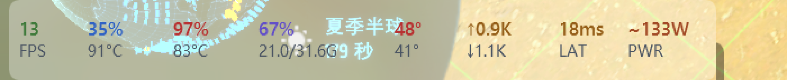

# M3.0 任务栏模式阶段报告

- 日期：2026-10-29
- 提交：`d30df94`（第一版，B 方案）/ `9e89f59`（explorer 重启恢复）/
  `523d1fa`（位置检测与降级）/ `d905568`（**B → A 方案改造**）
- 范围：需求 7.1–7.4 的第一版（嵌入方式 / 布局 / 尺寸 / 八字段）
  \+ 7.7（explorer 重启恢复、位置检测与降级、自动隐藏的配色防护）
- 当前形态：**顶层窗口盖在任务栏左侧空白区，显示八格指标，随任务栏高度自适应，
  右键可切文字配色，explorer 重启后约 4 秒自动归位，竖向任务栏/自动隐藏时自动藏**
- 方案变更：原按 7.1 的优先级走 B（`SetParent` 子窗口），实测发现**退出必留残影**
  且无解，改走 A（顶层窗口）。原因与证据见 2.4。
- 未含：穿透 + 托盘右键（7.6，Q-12）、字段开关（7.4 的"可开关"）、tooltip（7.6）、副屏任务栏

---

## 1. 交付内容

| 文件 | 内容 |
| --- | --- |
| `TaskbarWindow.xaml` / `.xaml.cs` | 任务栏条：八字段两行式、直角、定位/配色/菜单、存活巡检（A 方案：顶层窗口 + 屏幕坐标） |
| `Interop/Taskbar.cs` | 找任务栏、量空白宽度、`AttachAsTopLevel`（A 方案）、`Attach`/`Detach`（B 方案，已弃用保留备查）、置顶、采样亮度、枚举遮挡者、判活/提权检测 |
| `Interop/ScreenCapture.cs` | 新增 `SaveWindowPrint`（PrintWindow，含零初始化 DIB） |
| `Sdk/DashboardState.cs` | 新增四个任务栏专用字段（硬盘温度 / 上下行 / 延迟 / 功耗） |
| `Sdk/FloatField.cs` | 新增 `OnLightAlt`：第二个视图的明暗主题 |
| `Sdk/ConfigStore.cs` | 新增 `TaskbarInk` |
| `App.xaml.cs` | `--tray` / `--tray-raise` / `--taskbar-probe` / `--tray-probe` / `--tray-restart-probe` / `--force-edge` |

---

## 2. 嵌入方式：先试 B，最后退回 A

### 2.1 实测环境

| 项 | 值 |
| --- | --- |
| 系统 | Windows 11 build 26200（24H2/25H2 线） |
| 缩放 | 150%（任务栏 DPI 144） |
| 任务栏矩形 | `(0,1528)-(2560,1600)`，**高 72 物理像素 = 48 DIP** |
| 任务栏对齐 | **左对齐**（开始按钮在 647–714，不在正中） |
| 左侧空白 | `0–647` 物理像素（428 DIP），但其中 `0–~450` 被 **Widgets 天气**占据 |
| 应用图标区 | `714–1440`（`ReBarWindow32`） |
| 托盘区 | `1990–2560`（`TrayNotifyWnd`） |
| 内部结构 | `Shell_TrayWnd` → `Windows.UI.Composition.DesktopWindowContentBridge`（XAML 岛，整条覆盖） |

### 2.2 B 方案可行，但会被 XAML 岛压住

`SetParent(hwnd, Shell_TrayWnd)` + `WS_CHILD` 在这台机器上**确实生效**：
子窗口被接受、`GetParent` 返回任务栏句柄、`GetWindowRect` 位置正确、内容会绘制。

**但任务栏的可见内容由 XAML 岛（Composition）合成**，它不是 GDI 层。
结果是：**Widgets、应用图标、时钟永远画在子窗口之上**，重叠处子窗口被盖住。
条只能显示在 XAML 岛"没有内容"的位置。

这是 B 方案的天花板，不是 bug 修不掉的。需求 7.1 已经预警过
「Win10 图标左对齐时左侧常常没有足够空白」，本机就是这个形态的 Win11 版。

**但真正让 B 方案出局的不是这个**，而是 2.4 说的残影问题 —— 相比之下
"被 Widgets 盖住一段"只是好看不好看，残影是"退出后任务栏永远挂着一块死画面"。

### 2.3 A 方案（顶层窗口 + topmost）同样可行，且能盖住一切

红块实验验证过：顶层 `topmost` 窗口能盖住任务栏，也能盖住全屏游戏。
代价是**全屏应用时它还在**（7.8「全屏自动切换」要处理的就是这个）。

### 2.4 B 方案的致命缺陷：退出必留残影（决定放弃 B）

实测发现：CoPul 退出后，**任务栏上那块八格指标还在**，数值冻结在退出前一刻。

一开始以为是进程没退干净，四路检查全部否定：

| 检查 | 结果 |
| --- | --- |
| 哪个进程加载了 `CoPul.dll` | 没有，一个都没有 |
| `EnumChildWindows(Shell_TrayWnd)` | 只有 4 个 explorer 自己的子窗口，没有我们的条 |
| 该坐标 `ChildWindowFromPointEx` | 返回 `0`，那里没有窗口，鼠标点得穿 |
| 间隔 3 秒连拍两张比像素 | **50400 个像素 100% 相同，单通道最大差异 0** |

活着的仪表盘不可能 3 秒一个像素都不变。结论：那是**一张被冻结的画面**，
不属于任何进程。

**根因**：任务栏的可见内容由 XAML 岛（`DesktopWindowContentBridge`）用 Composition
渲染，**不响应 GDI 重绘**。跨进程 `SetParent` 的子窗口消失后，DWM 不会为父窗口
重绘那一块，于是最后一次合成的结果原样留在屏幕上。

用六种手段尝试在退出时擦掉它，**全部失败**：

| 手段 | 结果 |
| --- | --- |
| `Hide()` 后立刻销毁 | 留残影 |
| `Hide()` + `Detach` + 销毁 | 留残影（`Detach` 是负优化，见下） |
| `Hide()` + `DwmFlush()` 等一次合成 | 留残影 |
| 移到父客户区外（-20000）再销毁 | 留残影 |
| 销毁前 `Opacity = 0` 渲成全透明 | 留残影 |
| 关掉窗口透明表面（`--tray-opaque`） | 留残影，只是更淡 |

`Detach` 反而是负优化：它把窗口从子窗口变回顶层窗口，坐标从"相对任务栏客户区"
变成屏幕坐标 —— 正好还是任务栏那一行，而它内部的 `SetWindowPos(SWP_FRAMECHANGED)`
会强制 DWM 在新位置重画一次，等于在残影之上又盖一帧。

对照实验还确认了**Hide 本身没问题**：进程存活期间把条 Hide 掉，画面立刻干净
（DWM 有充足时间重绘）。卡住的是"Hide 完马上销毁"这个时序，
以及"任务栏那块区域根本不会被重绘"这个事实。

**唯一能清掉残影的办法是重启 explorer**（重建整个 XAML 岛）。这对用户显然不可接受：
每退出一次 CoPul 就要重启一次资源管理器。所以 B 方案出局。

### 2.5 A 方案的代价

改用顶层窗口后，残影问题从根上消失（顶层窗口有完整的 DWM 表面，销毁时 DWM 正常合成），
但有几件事从"白送"变成"要自己做"：

| | B（子窗口） | A（顶层窗口） |
| --- | --- | --- |
| 退出留残影 | **是，只能重启 explorer 清** | 否 |
| 跟随任务栏自动隐藏 | 白送（父窗口裁剪） | 要自己判断矩形是否滑出屏幕 |
| 被 Widgets / 图标盖住 | 是 | 否（反而盖住它们） |
| 全屏应用时 | 跟随任务栏一起被盖 | 仍浮在上面（7.8 要处理） |
| 坐标体系 | 相对任务栏客户区 | 标准屏幕坐标 |
| explorer 重启 | 窗口被连带销毁，要整窗重建 | 窗口不受影响，只换锚点重新定位 |
| 窗口背景 | 靠父窗口透出来 | 必须自己给（WPF 非 layered 窗口丢弃 alpha） |

---

## 3. 三个把实验带偏过的坑

### 3.1 全屏应用会盖住任务栏，制造"挂载失败"的假象

第一次做红块实验时，屏幕截图里的任务栏区域显示的是一排白色图标 + 青色进度条 + `376 MJ`。
当时以为是"任务栏被某种美化工具改写了"。

真相：**《戴森球计划》（`DSPGAME`, Unity, 全屏 2560×1600）正在前台**，
它盖住了整条任务栏。截图拍到的全是游戏 HUD。`MJ` 是戴森球里的能量单位。

`--taskbar-probe` 里加了一段"与任务栏区域相交的顶层窗口"，一次就看清了：

```
0x6F1666 [DSPGAME] class=UnityWndClass title="Dyson Sphere Program" rect=(0,0)-(2560,1600)
0x50240 [explorer] class=Shell_TrayWnd ...
```

**教训**：`Shell_TrayWnd` 的 `rect` 永远正确，它不知道自己被盖住了。
判断"任务栏可见不可见"必须另外查遮挡。

### 3.2 PrintWindow 有两次不同的骗人方式

| 用法 | 结果 |
| --- | --- |
| `PrintWindow(子窗口)` | 全黑。子窗口没有独立的 DWM 重定向表面 |
| `PrintWindow(任务栏)` | 一开始能拍到子窗口内容（红块可见），后来**返回 `true` 却是旧表面** |

第二次的细节：子窗口列表里明明已经没有 CoPul 的窗口，`PrintWindow` 却还给出一张
满是红块的图 —— 那是上一轮实验留下的表面。用 `print=True` 完全看不出问题。

于是顺手修了一个更隐蔽的东西：原来用 `CreateCompatibleBitmap`，
**它不清零**，PrintWindow 失败时留下的是上一次复用的堆内存，
"没拍到"会被读成"拍到了上一张图"。改成 `CreateDIBSection`（像素内存由系统零初始化），
失败就是全黑，不会骗人。

**最终判定只认屏幕抓取**；为了绕开全屏遮挡，加 `--tray-raise`：
截图前 `SetWindowPos(Shell_TrayWnd, HWND_TOPMOST)`，拍完立刻 `HWND_NOTOPMOST`。
只是临时的 Z 序调整，不改用户的任务栏设置。

### 3.3 子窗口坐标：屏幕坐标会让条跑到屏幕外

`Reposition()` 里原本写：

```csharp
Monitors.SetBounds(Handle, barRect.Left + LeftInset, barRect.Top, width, height);
```

作为子窗口，坐标必须**相对任务栏客户区**。传 `barRect.Top = 1528` 等于把条放到
父客户区的 y=1528 —— 屏幕外。`GetWindowRect` 报 `(8,3056)`，正好是 `2 × 1528`，
看起来像"父偏移被加了两遍"，实际是自己传错了。

改成 `SetBounds(Handle, LeftInset, 0, ...)` 后立刻正常。

**教训**：`SetParent` 之后，`Window.Left/Top`、`GetWindowRect` 与 `SetWindowPos`
三者的坐标语义分家了。子窗口只有 `SetWindowPos` 的 `x/y` 是相对父的，
`GetWindowRect` 仍返回屏幕坐标 —— 这个不对称最容易写错。

### 3.4 `TaskbarCreated` 广播收不到：UIPI 拦了，不是没广播

需求 7.7 的标准做法是监听 `RegisterWindowMessage("TaskbarCreated")`。第一版就按这个写了：
单独建一个不显示的顶层 `HwndSource` 收广播（子窗口收不到 `HWND_BROADCAST`，
所以不能挂在条自己身上）。消息 id 拿到了 `49414 (0xC106)`，窗口也建好了，**但广播一条没来**：

```
18:00:54.663 attach: bar=0x30670 ok=True
18:00:54.974 watcher: msg=49414
18:00:54.993 watcher: hwnd=0x605CE
（之后再无任何日志，explorer 确实被杀了又起来）
```

同一个进程里加一行体检就水落石出：

```
watchdog: 启动 elevated=True
```

**explorer 以中完整性运行，CoPul 这个实例是提权的（高完整性）。
UIPI（User Interface Privilege Isolation）会丢弃低完整性 → 高完整性的窗口消息，
`SendMessageTimeout(HWND_BROADCAST, ...)` 也在拦截范围内。** 广播其实发了，只是到不了我们。

本项目的常规启动方式（`start-tray.vbs` → `ShellExecute runas`）恰恰是提权的，
所以这不是"自测环境特有"，正式运行同样收不到。**广播这条路在本项目里只能当加速手段，
不能当唯一手段。**

结论：加了 1 Hz 的存活巡检（只做两次 `IsWindow`，任务栏活着时连
`FindWindow` 都不进），广播监听保留 —— 非提权运行（开机自启的常规场景）时它能更快响应。

### 3.5 判活不能用 `WindowInteropHelper.Handle`

第一版巡检代码：

```csharp
IntPtr hwnd = Handle;                 // WindowInteropHelper.Handle
if (hwnd == IntPtr.Zero) return;      // ← 把"已销毁"当成了"未初始化"
if (!Taskbar.IsAlive(hwnd)) Recover();
```

窗口被父窗口连带销毁后，`WindowInteropHelper.Handle` 返回 `IntPtr.Zero`，
于是巡检每次都从第二行返回，**日志上什么都看不到，条就是不见了**。
现象与"巡检没跑"完全一样，极其误导（第一次验证就是这么静默失败的）。

改法：`Attach()` 时把 HWND 缓存进 `_hwnd`，巡检只认 `_hwnd`。
`_hwnd` 非零但 `IsWindow` 为假，才是真的没了。

---

## 4. 配色：为什么"跟随系统"不能读注册表

需求 7.5 写的是「读 `SystemUsesLightTheme` 注册表项」。

实测这台机器：`SystemUsesLightTheme = 1`（浅色），**但任务栏实际是深蓝灰 `#314450`**。
原因是 Win11 的任务栏是**跟随壁纸**的半透明层，壁纸是暗色星球，任务栏就暗。

按注册表判断 → 深底配深字 → 什么都看不见。第一版截图就是这个结果。

改成**采样任务栏实际亮度**：在托盘左侧的空白段取 5 个点算平均 luma，
`> 128` 判为浅底。窗口初次渲染后采样一次，`WM_SETTINGCHANGE` / `WM_DISPLAYCHANGE`
时重采。保留手动锁定（浅色字 / 深色字）作为兜底。

另外给条垫了一层 40% 对比底：完全透明时（7.5 的"跟随系统"原意），
深色字压在亮橙色壁纸上直接糊掉。垫底后任何壁纸上都能读，
视觉上也还是一个"任务栏上的小组件"。

---

## 5. 布局与实测

八字段按 7.4 的顺序，两行式（上行值、下行标签）：

| # | 字段 | 显示 | 列宽 DIP |
| --- | --- | --- | --- |
| 1 | FPS | `63` / `FPS` | 34 |
| 2 | CPU | `52%` / `88°C` | 44 |
| 3 | GPU | `59%` / `76°C` | 44 |
| 4 | 内存 | `78%` / `24.7/31.6G` | 74 |
| 5 | 硬盘温度 | `50°` / `41°`（上行盘1、下行盘2） | 36 |
| 6 | 上下行 | `↑4.6K` / `↓6.0K` | 48 |
| 7 | 延迟 | `25ms` / `LAT` | 34 |
| 8 | 整机功耗 | `~109W` / `PWR` | 44 |

排版总量：`358（列宽）+ 7×7（间距）+ 12（内边距）= 419 DIP = 629 px`，
可用 647 px，余量 18 px。

三处偏离需求原文的地方，都是被宽度逼出来的：

1. **速率写成 `↑1.2M` 而不是 `↑1.2M/s`**：48 DIP 放不下 7 个字符，
   `/s` 是恒定后缀，省掉不影响读解。
2. **圆角用 6 DIP 而不是 7.3 写的直角**：垫了对比底之后，直角显得像"贴了块胶布"。
   若要严格对齐需求可以改回 0。
3. **功耗 `~109W` 的 `~` 保留**（7.4 明确要求是估算值），
   它只累加 CPU 封装 + GPU 板卡 —— 主板/硬盘/风扇的功耗 Windows 拿不到，
   所以这是**下限**估算。

### 5.1 7.7 实测：explorer 重启后自动恢复

`--tray-restart-probe` 在启动 3 秒后 `taskkill /f /im explorer.exe` 再拉起，
第 20 秒截图。日志（节选，`%TEMP%\copul-tray.log`）：

```
18:05:19.913 attach: bar=0xA03A2 ok=True hwnd=0x1B0688
18:05:24.146 watchdog: 条 hwnd=0x1B0688 已被销毁 → 重建      ← 杀 explorer 后 4.2 s
18:05:24.195 watcher: msg=49414                              ← 新实例的广播监听
18:05:24.901 reattach#0: bar=0x280DDA                        ← 新任务栏就绪
18:05:24.902 reattach#0: alive=True hwnd=0x3308D6
18:05:25.002 attach: bar=0x280DDA ok=True hwnd=0x3308D6      ← 重挂成功
```

结果：

```
bar  : 2560×72 px at (0,1528)
bar  : rect of strip = (8,1528)-(637,1600)     ← 629×72，位置与高度都对
place: bar=(0,1528)-(2560,1600) free=640 need=629 used=629 scale=1.50
```

整条链路：**巡检发现子窗口被连带销毁 → 交 App 关闭旧实例并新建 → 新实例挂载时
任务栏还没起来 → 700 ms 重试拿到新 `Shell_TrayWnd` → 挂上并重新采样配色**。
从杀掉 explorer 到条回到屏幕上是 **约 4.9 秒**（4.2 s 发现 + 0.7 s 重试）。

改 A 方案后这条链路短了一截：顶层窗口**不会**被 explorer 连带销毁，
不需要关窗重建，只要换掉"任务栏"这个锚点重新定位（`d905568` 实测）：

```
18:51:32.139 attach(top-level): bar=0x2203A2 ok=True hwnd=0x1AC19E0
18:51:36.241 watchdog: 任务栏换了（0x2203A2 → 0x22030C）   ← 杀 explorer 后 4.1 s
bar  : rect of strip = (8,1528)-(637,1600)                 ← 自动回到新任务栏
```

`ScheduleReattach` 的 700 ms 重试链仍然保留 —— 巡检正好撞上任务栏还没建好的时候，
`Find()` 会返回 0，靠它兜住。

> **视觉验收说明**：第一次验证时抓到的画面是游戏的 HUD 而不是桌面 ——
> 抓屏那一刻任务栏处于**独占全屏**之下，桌面根本没有被合成到显存里，
> 任何抓屏（含 `PrintWindow`、临时置顶）都拿不到。退出全屏后重拍即成功，
> 见 5.2。

### 5.2 位置检测与降级（7.7 / Q-13）

只处理**横向**任务栏（底部、顶部）。竖向任务栏（左/右）宽度只有 72 px，
八格横排根本放不下，硬塞会得到一条被压扁的怪窗口 —— 所以直接不画，
用户把任务栏挪回上下时自动恢复。

判定走 `SHAppBarMessage(ABM_GETTASKBARPOS)` 的 `uEdge`，**不拿矩形跟屏幕比**：
自动隐藏时整条任务栏滑出屏幕，矩形反推会得出"既不在上也不在下"的错误答案。

自动隐藏不需要额外处理：条是任务栏的**子窗口**，父窗口滑出屏幕时会被裁剪，
天然跟着一起走。要防的是**采样配色** —— 任务栏滑走后采样点落在屏幕外，
`GetPixel` 一律返回 `CLR_INVALID`。现在 `SampleLuma` 会：

1. 把采样 y 夹回可见屏幕范围；
2. 一个有效像素都取不到时返回 **-1**，调用方沿用上一次判断。

（早先的实现把"没采到"当 128，再拿 `> 128` 一比就翻成浅底 → 深色字，
任务栏滑回来是深底深字，一片糊。）

验证手段是 `--force-edge bottom|left|top`：只伪造**判定结果**，
`SetParent`、摆位、隐藏全走生产路径 —— 因为真去挪任务栏等于改用户的系统设置。

| `--force-edge` | 结果 |
| --- | --- |
| `bottom` | `edge=Bottom`，条在 `(8,1528)-(637,1600)`，正常 |
| `top` | `edge=Top`，同上（相对父客户区，顶部任务栏同样贴父的左上角） |
| `left` | `suppressed: 竖向任务栏暂不支持`，条被 `ShowWindow(SW_HIDE)` 藏起来 |

**自动隐藏未实测**（要改系统设置），逻辑上是白送的裁剪行为；
`ABM_GETSTATE` 读到的 `autohide` 已经写进 `PlacementDiag`，真出问题能一眼看到状态。

### 5.3 真实截图

游戏退出后重拍（任务栏区域 2560×72，左侧 700 px 放大 3 倍）：



八组全部显示完整：`13 FPS` / `35% 91°C` / `97% 83°C` / `67% 21.0/31.6G` /
`48° 41°` / `↑0.9K ↓1.1K` / `18ms LAT` / `~133W PWR`。
颜色是「深色字」档（`TaskbarInk=Dark`）：垫了 40% 白底，暗色字在亮壁纸上依然可读。

**可见的问题**：Widgets 的天气（`夏季半球 179秒`）正好压在
**硬盘温度**那一列上，`48°` 和它糊在一起。这就是 2.2 说的 XAML 岛压盖。
**改 A 方案后这条自动消失了** —— 顶层窗口在任务栏之上，反而把 Widgets 盖住了。

---

## 6. 已知限制

| 限制 | 说明 |
| --- | --- |
| 全屏应用时条仍浮在上面 | A 方案的固有代价。B 方案时是"跟着任务栏一起被盖"，A 方案下要自己做全屏检测（第 8 章） |
| 盖住了 Widgets | A 方案反向的结果：条在任务栏之上，本机 Widgets 天气被压掉。要么接受、要么缩窄让开 |
| 竖向任务栏不显示 | 左/右停靠时主动隐藏（放不下），挪回上下自动恢复，见 5.2 |
| 只支持主屏 | 副屏 `Shell_SecondaryTrayWnd` 未挂 |
| 自动隐藏未实测 | 已实现（任务栏整条滑出屏幕时 `Suppress`），但没真机证据（要改系统设置才能测） |
| 没有穿透 | 7.6 的 Q-12 采纳"默认穿透 + 托盘右键"，托盘尚未实现。A 方案下加 `WS_EX_TRANSPARENT` 即可 |
| 字段不能单独开关 | 7.4 的"可开关"未做 |
| 底色靠 accent 亚克力 | WPF 非 layered 窗口丢弃 alpha，必须自己给底；目前是 Acrylic + 40% 遮罩，与任务栏底色不完全一致 |

---

## 7. 下一步

1. 托盘图标 + 穿透（7.6 的 Q-12 完整形态）—— A 方案下穿透就是加一个
   `WS_EX_TRANSPARENT`，比 B 方案时简单得多
2. 字段开关菜单（7.4）
3. 全屏自动切换（第 8 章）—— A 方案下**必须做**，否则玩游戏时条会浮在画面上
4. Widgets 重叠：现在变成"条盖住了 Widgets"，要不要缩窄让开需要拍板
5. 副屏任务栏（`Shell_SecondaryTrayWnd`）
