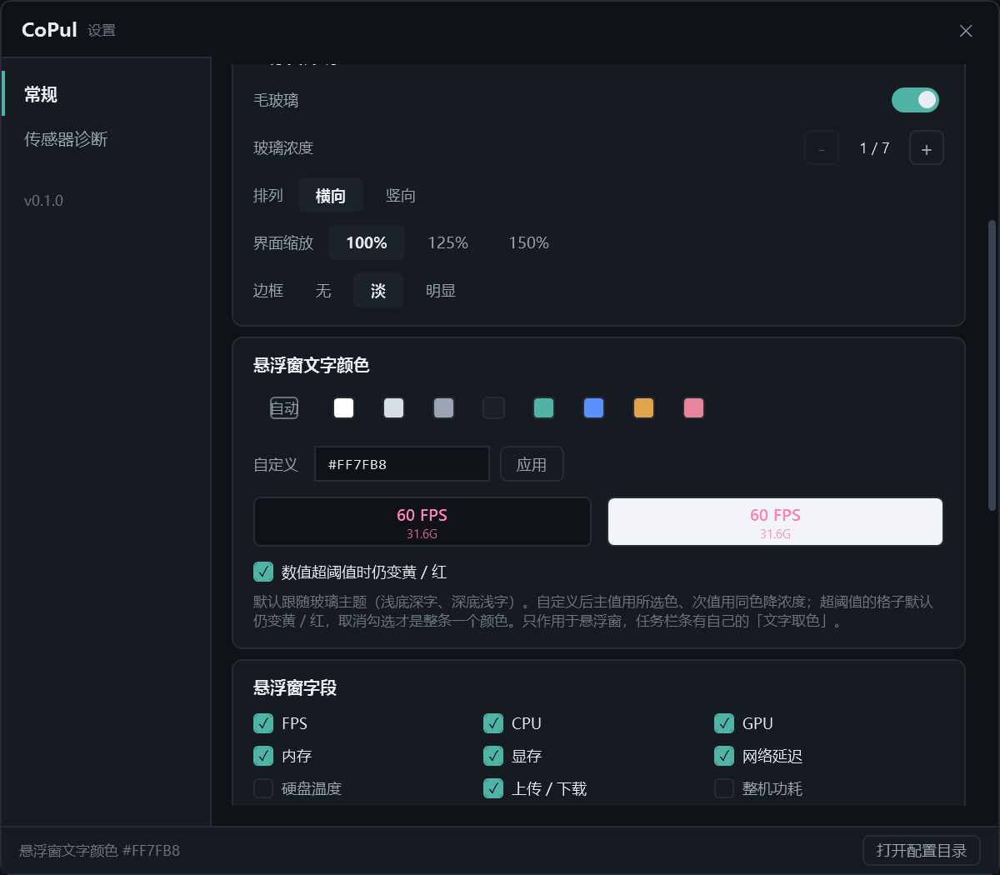

# M4.19 悬浮窗文字颜色可自定义

> 需求来源：用户「我想要悬浮窗文字的给个字体颜色能够自定义」。
> 关联：M4.15 边框档位（同一类"没有唯一正确答案，交给用户挑"的设置）、M4.18 悬浮窗九字段。

## 1. 要解决的问题

悬浮窗的文字色一直是**配色表里写死的**：主值走语义色 + 阈值色（CPU 蓝、GPU 青、超阈值转黄/红），
次值走 `BrushTextSecondaryLight`（浅底）/ `BrushTextSecondary`（深底）。这套色在
"七档浓度 × 深浅两档主题"里是配好的，但用户没有入口改它 —— 想让整条是白色、是青色，做不到。

选型（与用户确认）：

| 维度 | 选择 | 理由 |
|---|---|---|
| 作用范围 | **主值 + 次值一起改，可保留阈值色** | 一个色控两段字；另给开关"超阈值仍变黄/红"（默认开），不让自定义把告警一起刷掉 |
| 选色交互 | **预设色板 + 十六进制输入** | WPF 没有内置取色器；8 个低饱和预设 + `#RRGGBB` 输入框够用，不占半页 |

## 2. 改动

| 文件 | 改动 |
|---|---|
| `Sdk/FloatInk.cs`（新） | 颜色写法解析 / 规范化 / 预设色板 / 次值降浓度画刷 |
| `Sdk/ConfigStore.cs` | `FloatTextColor`（`#RRGGBB`，空 = 自动）、`FloatTextKeepThreshold`（默认 true） |
| `Sdk/MetricCell.cs` | 公开只读 `Level`（只为一个判断服务：要不要放行阈值色） |
| `Sdk/FloatField.cs` | 新增 `OverrideBrush` / `SetOverride` —— **悬浮窗专属**覆盖通道 |
| `Sdk/DashboardState.cs` | `SetFloatText(brush, keep)` + `FloatOverride(cell)`；改色立即重刷，不等下一拍 |
| `FloatWindow.xaml.cs` | `TextColor` / `TextKeepThreshold` 两个属性、`TextDiag`（sidecar） |
| `SettingsWindow.xaml(.cs)` | 「悬浮窗文字颜色」卡片：色板 + 自定义输入 + 深/浅底双预览 + 阈值开关 |
| `App.xaml.cs` | `--float-text`、`--float-text-flat`、`--float-force-level`；sidecar 增 `text:` 行 |

### 2.1 一个色管两段字，但保留层次

主值 13px 粗、次值 10px 常规，原来两段的深浅关系（`#1B2027` / `#5C6672`）不能抹平 ——
全同色会让 34px 高的条看起来糊成一片。所以次值取**同色降浓度**：

```csharp
LabelBrush = _textBrush is null ? 主题次文字色 : FloatInk.ToSubBrush(_textBrush);   // alpha 78%
```

### 2.2 阈值色优先（本次唯一需要想清楚的取舍）

```csharp
private Brush? FloatOverride(MetricCell cell)
{
    if (_floatTextBrush is null) return null;                                  // 跟随主题
    return _floatKeepThreshold && cell.Level is Level.Warn or Level.Danger     // 超阈值放行阈值色
        ? null : _floatTextBrush;
}
```

悬浮窗是"扫一眼"看的，颜色是唯一不用读数的提示；把整条刷成一个颜色等于把告警一起刷掉。
所以**默认保留黄 / 红**，真要纯色由用户取消勾选。`Muted`（该指标不可用）不算阈值 ——
那一格是 `—`，本来就没有"超没超"，跟着自定义色走。

### 2.3 覆盖通道必须只给悬浮窗（本次踩到的坑）

第一版把自定义色塞进了 `FloatField.Set(top, bottom, lightBrush, darkBrush)` 那两个参数里。
那两个画刷**同时被任务栏条用着**（`TopBrushAlt = OnLightAlt ? _lightBrush : _darkBrush`），
而九个 `FloatField` 是悬浮窗与任务栏共用的 —— 结果就是改悬浮窗颜色，任务栏跟着一起染。

改成悬浮窗专属的 `OverrideBrush`：`TopBrush` 读它、`TopBrushAlt` 不读。
调用点（`DashboardState` 的 10 处 `FloatXxx.Set(...)`）恢复成原来的 `cell.ValueBrushOnGlass, cell.ValueBrush`，
自定义色只走 `SetOverride`。**验证见 §3 第 4 条：任务栏粉色像素 0。**

### 2.4 探针不污染配置

`--settings-probe "textcolor:#00E5FF,textthr:0"` 改的是共享的那份 `AppConfig`，
而主窗口关闭时也会整份落盘 —— 照 M4.14 的老规矩加了备份 + `Application.Exit` 末尾还原
（`BeginTextProbeBackup` / `RestoreTextProbe`）。实测：探针期间打印 `cfg=#00E5FF`，
进程退出后 `config.json` 仍是 `"" / true`。

## 3. 运行取证（0 警告 0 错误，运行副本 `D:\CoPulRun`）

sidecar 新增一行 `text: cfg=… keepThreshold=… main=… label=… live=…`，
其中 `live` 是 **FPS 那一格实际的前景画刷**（证明颜色真的落到了元素上，不只是配置写了）。

| # | 场景 | 结果 |
|---|---|---|
| 1 | 默认（auto） | `cfg=auto main=null label=#FF9AA4B2 live=#FF9AA4B2`；图里有 `#E0A44A`（琥珀）、`#B98FE8`（显存紫）等语义色 → 各格仍是各自的颜色 |
| 2 | `--float-text "#FF7FB8"` | `main=#FFFF7FB8 label=#C8FF7FB8 live=#FFFF7FB8`；截图里 `#FF7FB8` 精确像素 **901**、含抗锯齿 2897，且不再有其它语义色 |
| 3 | 同上 + `--float-force-level danger` | 出现 `#D95C5C`（危险红 **413 px**）与粉色共存 → **阈值色压过自定义色**；FPS 格（`—`，Muted）仍是粉 |
| 4 | 同上 + `--float-text-flat 1` | `#D95C5C` **0 px**，全粉 → 关掉开关后才是真正的"整条一个颜色" |
| 5 | 竖向（`--float-vertical`） | `47.33×309.33 DIP`，`live=#FF00E5FF` → 竖排同样生效 |
| 6 | 任务栏条（`--tray`），配置里预置 `#FF7FB8` | 粉色 **0 px**；颜色仍是任务栏自己的 `#4B5563` / 语义色 → **任务栏未被串色** |
| 7 | 设置页探针 `textcolors` | 9 个色板（自动 + 8 色）齐全；`hexBox='#FF7FB8'`、`thr=False`、预览两块 `darkMain=#FFFF7FB8 / lightMain=#FFFF7FB8` |
| 8 | 探针还原 | 跑完 `config.json` 仍为 `FloatTextColor=""`、`FloatTextKeepThreshold=true` |

### 设置页截图（滚动到该卡片）



卡片四部分：① 色板（「自动」+ 白/浅灰/银灰/墨黑/青/蓝/琥珀/藕粉）；② 「自定义」输入框 + 应用；
③ 深底 / 浅底两块预览（主值 + 次值两段一起看）；④ 「数值超阈值时仍变黄 / 红」勾选框。

「自动」那一格单独处理过：32px 固定宽会把"自动"的第二个字挤出框外（截图里只露半个字），
且其底色 `BrushPanel` 与卡片底色几乎一体 —— 改成宽度自适应 + `Padding 9,3` + 边框提亮一档。

## 4. 自测开关

```
--float-text #RRGGBB|auto      悬浮窗文字颜色（不落盘，配合 --shot 量实际前景色）
--float-text-flat 1            连阈值色一起盖掉（整条一个颜色）
--float-force-level warn|danger 强制全部格子进阈值态（本机平时一项都超不了阈值）
--settings-probe "textcolor:#FF7FB8,textthr:0,textcolors"
```

`--float-force-level` 是为 §3 第 3/4 条新加的：阈值色那条分支平时永远走不到，
不改数据就看不出"谁优先"，而它只影响 `SetCell` 计算出的 level，`Muted`（无数据）不强制。

## 5. 未做 / 待办

- 悬浮窗右键菜单没有加入口（菜单里「设置…」一直是 `IsEnabled=False`）；改色目前只能从设置页进。
- 任务栏条仍是自己的「文字取色」三档（Auto / 浅色底 / 深色底），没有跟着加自定义色 ——
  它的底色由系统任务栏决定，套同一个色大概率读不出来。
- 次值固定 78% 浓度，暂不可调（想"两段完全同色"再说）。
