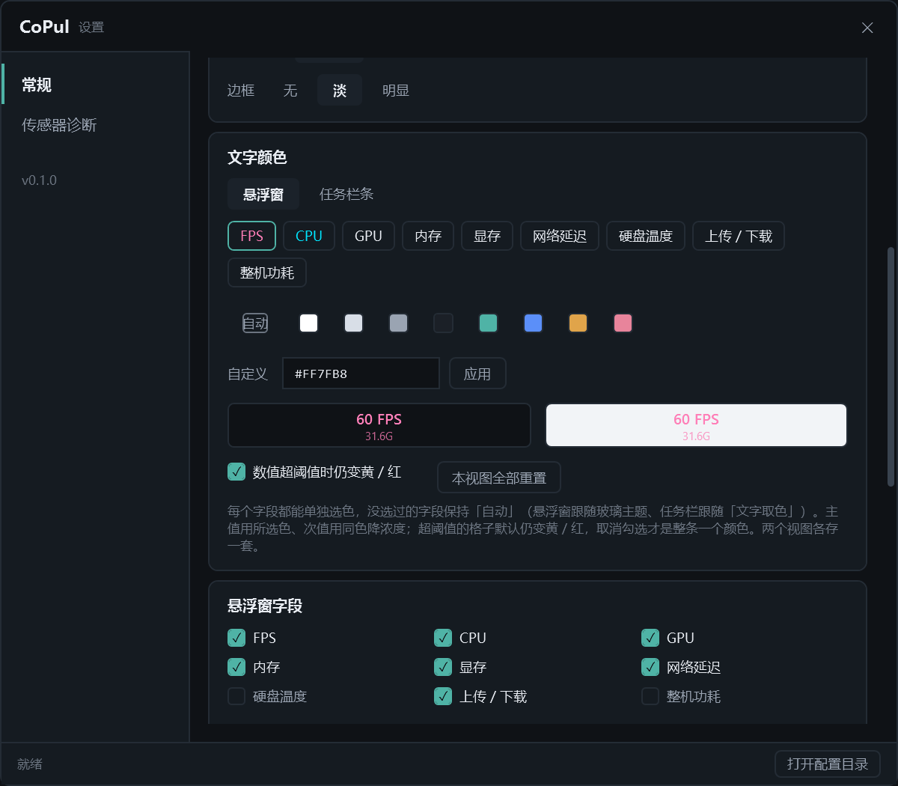
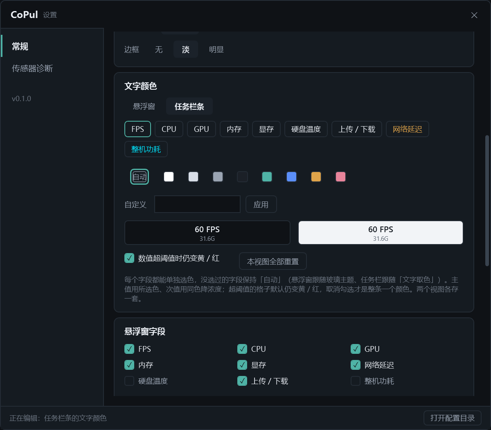

# M4.20 逐字段文字颜色（悬浮窗 + 任务栏条）

> 上接 `M4.19-悬浮窗文字颜色报告.md`。M4.19 给的是"整条一个色"，
> 用户要的是**每一格各配各的色**，并且**任务栏条也要**。本次两件事一起做。

## 需求

1. 悬浮窗九个字段**各自**能选色（不是整条一个色）。
2. 任务栏条同样能逐字段选色。

## 为什么必须做成两张表

两个视图的字段名**并不相同**：

| | 字段 |
|---|---|
| 悬浮窗 | fps · cpu · gpu · ram · vram · **net** · disk · io · pwr |
| 任务栏 | fps · cpu · gpu · ram · vram · disk · io · **lat** · pwr |

底层是同一批 `FloatField`（`Net` / `Lat` 两个对象都绑网络延迟，因为两处对这一个指标的叫法和位置不同）。
所以"改悬浮窗"和"改任务栏"必须走**两条互不相干的通道**：

```
FloatField
  TopBrush      = OverrideBrush     ?? (OnLight    ? light : dark)   ← 悬浮窗读（M4.19 已有）
  TopBrushAlt   = OverrideBrushAlt  ?? (OnLightAlt ? light : dark)   ← 任务栏读（M4.20 新增）
  SubBrush      = OverrideSub       ?? ThemedSub                     ← 悬浮窗次值
  SubBrushAlt   = OverrideSubAlt    ?? ThemedSubAlt                  ← 任务栏次值
```

M4.19 那次已经踩过一次：把自定义色塞进 `Set(lightBrush, darkBrush)` 那两套，
而这两套同时被 `TopBrushAlt` 用着 → 改悬浮窗会把任务栏一起染。
这次直接按"两视图各一路覆盖"设计，XAML 里任务栏绑 `SubBrushAlt`、悬浮窗绑 `SubBrush`。

## 配置

```jsonc
"FloatFieldColors": { "fps": "#FF7FB8", "vram": "#00E5FF" },   // 悬浮窗
"TrayFieldColors":  { "lat": "#E0A44A" },                      // 任务栏
"TextKeepThreshold": true                                      // 两视图共用
```

- **只存被改过的字段**，缺项 = 「自动」。九项全写一遍的话看不出改了哪几项，而且以后加字段要给老配置补种一遍。
- 旧版 `FloatTextColor` / `FloatTextKeepThreshold` 迁移一次就清空（`ConfigVersion` 2 → 3）：
  旧色铺到悬浮窗**九项**上（M4.19 那个色本来就只作用于悬浮窗，凭空染任务栏等于替用户改了他没改过的视图），
  旧开关只有 `false` 需要搬过来（`true` 本来就是默认值）。
- `System.Text.Json` 反序列化出来的字典用的是**默认**比较器，属性初始值里那个
  `OrdinalIgnoreCase` 根本传不进去 —— 读回来要重造一遍（`Rekey`），否则用户手改配置把 `fps` 写成 `FPS` 就不生效。

## 设置页

一张卡片管两个视图：**先选视图（悬浮窗 / 任务栏条），再选字段**，下面共用一套色板 + 十六进制输入 + 深/浅双预览。
九格 × 两个视图 = 18 个色，每个都摆一排色板会把设置页撑成一面墙，而一次只会调一格。

**字段条里的字用它自己的颜色显示** —— 九个格子里只改了三格时，"哪几格改过"不能靠记，
而色板一次只能反映一格的状态。另给「本视图全部重置」。




## 阈值色仍然优先（且每拍重算）

自定义色**不盖掉**告警色：CPU 92% 仍然变红。两个视图都是扫一眼看的，颜色是唯一不用读数的提示。
真要"整条一个颜色"取消「数值超阈值时仍变黄 / 红」即可（两视图共用同一个开关）。

> **这次修掉的一个真 bug**：覆盖色原先只在"改配置"时算一次。
> 而让不让位取决于**当前**的 `Level`，`Level` 每拍都在变 ——
> CPU 从 30% 冲到 92% 的那一次，只有那一拍的重算能把它变红。
> 只在配置变更时算一次，等于把告警色永久刷掉。
> 现在 `ApplySnapshot` 末尾每拍重算；**没有任何自定义色时整段跳过**，默认路径仍是零开销。

## 取证（0 警告 0 错误）

sidecar 新增逐字段的 `cfg / main / sub / live` 四列，`live` 是那一格 TextBlock **实际**的 Foreground
（配置写了 ≠ 落到元素上，中间隔着"阈值色让不让位"和"字段名对不对得上"两道）。

| 用例 | 结果 |
|---|---|
| 默认（全自动） | 九格各自保留语义色：cpu `#5B8FF9`、gpu `#4FB3A6`、ram `#9B8AFB`、vram `#B98FE8`… |
| 逐字段 `fps:#FF7FB8,cpu:#00E5FF,ram:#4FB3A6,vram:#E0A44A` | 四格换色（像素 150 / 244 / 821 / 1192），gpu·net·io 仍 auto；内存紫 `#9B8AFB`、显存紫 `#B98FE8` 均 **0 px**（确实被覆盖） |
| 全 danger + 自定义粉 | 有阈值语义的 cpu / gpu / net 变红 `#D95C5C`（任务栏侧是 `#B83232`）；fps / ram / vram / io 无阈值语义，保持粉色 |
| 关掉阈值开关（flat） | 红色 **0 px**，整条纯色 |
| 竖向排列 | 同样生效，尺寸 47.33×309.33 不变（改色不影响布局） |
| **互不串色** | 配置 `FloatFieldColors={fps}` + `TrayFieldColors={lat}`：跑任务栏 → fps 仍 auto、lat 琥珀；跑悬浮窗 → fps 粉、net 仍 auto |
| 迁移 | 旧配置 `FloatTextColor=#00E5FF` + `KeepThreshold=false` + `ConfigVersion=2` → 落盘后 version=3、九项全 `#00E5FF`、`TextKeepThreshold=false`、旧字段清空、任务栏表不动 |
| 落盘 | 窗口开着时改色 → `config.json` 立刻写入；探针跑完退出后配置还原成原值 |
| 设置页探针 | `textcolor:fps:#FF7FB8;cpu:#00E5FF`（**分号** —— 逗号被命令串自己占了）、`textview:tray`、`textfield:ram`、`textcolors` 打印两张表 |

新增自测开关：`--float-text fps:#FF7FB8,cpu:#00E5FF`（只写一个色 = 九格一起设）、
`--tray-text` 同写法、`--tray-force-level warn|danger`。
顺带修了 `--float-persist-probe`：它跟任何外观参数一起用都会被 `PersistToConfig=false` 挡掉，
而这个探针的用途恰恰是"连外观一起存"，现在会显式打开落盘。


