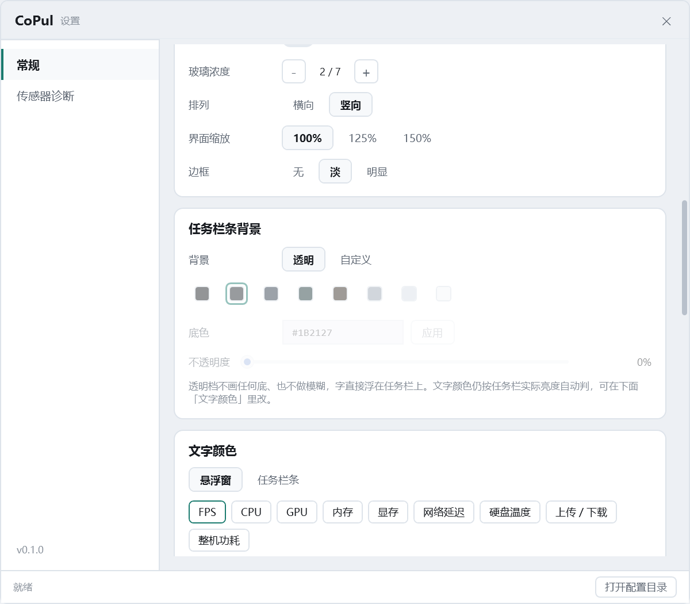

# M4.37 任务栏条背景：砍掉「跟随任务栏」，只留 透明 / 自定义

## 需求

「我说的跟随系统任务栏就是和透明一个意思，这个选项你直接将背景去掉就行了。」

M4.36 交付了三档（跟随任务栏 / 自定义 / 透明），其中「跟随任务栏」是在任务栏上垫一层
按亮度反色的对比底（浅底铺白 33%、深底铺黑 40%）。用户要的**不是**垫底，而是
"跟任务栏长一样"—— 那就是不画底，和「透明」完全同一件事。

所以：**删掉「跟随任务栏」这一档**，只剩 **透明（默认）/ 自定义**。

保留三档会留下两个点了效果完全一样的按钮，用户点完会以为是 bug —— 这比少一个按钮糟得多。

## 改了什么

| 位置 | 改动 |
| --- | --- |
| `Sdk/ConfigStore.cs` | `TaskbarBackdrop` 默认 `"auto"` → `"transparent"`；注释重写 |
| `TaskbarWindow.xaml.cs` | 删 `BackdropAuto` 常量；`ApplyBackdrop` 从三支 `switch` 改成"custom 一支 + 透明一支"；`NormalizeBackdrop` 把旧值 `auto` 与任何不认识的值都归一为 `transparent` |
| `SettingsWindow.xaml` | 分段按钮 3 → 2（「透明」在前、「自定义」在后）；文字取色那张卡的 ToolTip 同步改词 |
| `SettingsWindow.xaml.cs` | `_bgMode` 默认 `transparent`；`BarSegFor` / `NormalizeBgMode` 两值化；提示文案两档 |
| 探针 | `bg` 打印改成 `seg=[custom=…,transparent=…]`；`bgmode:auto` 仍可用（归一为 transparent） |

## 两个必须交代的实现细节

### 1. 旧配置里的 `"auto"` 自动迁移

不改用户已有的配置文件。`TaskbarWindow.NormalizeBackdrop` 里：只有 `"custom"` 是自定义，
其余（含 `"auto"`、空、乱写）一律 `"transparent"`。老配置读到 `auto` → 行为直接变成透明，
用户下次动一下设置才把字符串写回 `transparent`。

### 2. 透明档的"看不清"兜底

透明档的透明完全靠 DWM accent 的 `BLURBEHIND` 撑（着色基底 0、不做模糊）。
如果 `AttachAsTopLevel` 失败（`_attached == false`），没有 accent 就只剩 WPF 自己的表面，
而 alpha 会被 DWM 丢掉 → **整条看不见**，用户会以为程序挂了。

删掉 auto 之后没有"垫底档"可以 goto 了，所以在透明分支里显式留了一条兜底：
`!_attached` 时退回原来那层薄对比底（浅底 `#55FFFFFF` / 深底 `#66000000`）并保留窗口边框。
正常路径永远走不到，但它是"改一行让整条消失"这类事故的最后一层网。

## 验收

Release 编译 **0 警告 0 错误**。取证用独立副本 `D:\CoPulProbe`，串行跑、用完即退。
条 rect = `(8,1528)-(688,1600)`，`--shot-screen` 的 PNG 原点 = 任务栏左上角，采样行 `y=36`。

### 1. 旧配置 `auto` → 透明（迁移生效）

配置原值为 `TaskbarBackdrop: "auto"`，直接启动：

```
taskbarbg: mode=transparent color=#1B2127 opacity=0 customEnabled=False
           seg=[custom=False,transparent=True]
taskbarbg: window=backdrop=transparent shell=#00FFFFFF glass=Accent Blur（极透…）
```

`shell=#00FFFFFF`（alpha 全 0）说明窗口侧真的不画底了，不是只改了控件。

### 2. 透明档像素：与紧邻任务栏齐平

| 位置 | 采样值 | luma |
| --- | --- | --- |
| 条内 `x=686`（右端内侧） | (65,65,76) | 66 |
| 条内 `x=687` | (66,66,77) | 67 |
| 紧邻条外 `x=692` | (51,51,66) | 52 |
| 紧邻条外均值 `x=690..699` | (55,58,73) | 62 |

条右缘不再有台阶 —— 与 M4.36 透明档实测（`x=686` luma 66）完全一致，说明砍掉垫底后
走的就是原来那条透明路径。裁剪图里看不出任何矩形块或描边（`docs/M4.37-…-透明.png`）。

> 沿 `y=36` 横向从左到右亮度从 100 降到 66，那是**壁纸本身**的横向渐变（任务栏是跟随壁纸的
> 半透明），不是条画的底 —— 判断只能看"紧邻条内外的差分"，不能看整行的绝对值。

### 3. 自定义档没被改坏

```
taskbarbg: mode=custom color=#243040 opacity=70 customEnabled=True
           seg=[custom=True,transparent=False]
taskbarbg: window=backdrop=custom shell=#B2243040 glass=Accent Acrylic
```

`#B2` = 178 ≈ 70%。条内 `x=100` = (51,60,78)、`x=600` = (54,62,78)，蓝灰实底；
右缘 `x=686` = luma 94（DWM 边框仍在，自定义档保留），与透明档的 66 形成对照 ——
两档的边框处理确实是独立分派的。

### 4. 设置页



分段只剩「透明 / 自定义」，透明为选中态；自定义那一块置灰不隐藏（行高不跳）。
提示文字随档位换：透明档为
「透明档不画任何底、也不做模糊，字直接浮在任务栏上。文字颜色仍按任务栏实际亮度自动判，可在下面「文字颜色」里改。」

### 5. 配置还原

取证前备份 `D:\copul-config-before-m437.json`，收尾 `cp` 回去并逐字段 diff —— 一致
（`TaskbarBackdrop` 仍是 `auto`，运行时归一为 transparent，不写脏用户配置）。

## 一句话

**"跟随任务栏"和"透明"是同一个意思 → 只剩一档。** 字色仍然按任务栏实际亮度自动判，
那属于「文字取色」，跟这里给不给底是两件事。
