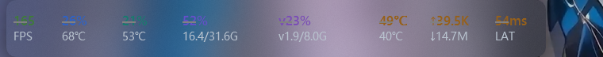
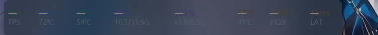

# M4.38 透明档改成真·逐像素透明（任务栏条改 layered 窗口）

## 需求

「透明选箱还不是彻底的没有背景，我想要的是透明模式直接没有背景，直接将数据显示在任务栏上面。」

M4.37 的透明档是 `ACCENT_ENABLE_BLURBEHIND` + `tint alpha = 0` 冒充出来的"透明"：
底色确实没有，但 **accent 本身是 DWM 在窗口背后注入的一层模糊**。用户看到的
"还有背景"，就是那一层被抹平的雾。

## 根因：非 layered 窗口没有 alpha

决定性实验（`--accent-state 0` 彻底禁掉 accent，其余不变）：

| 配置 | 条内区域 |
| --- | --- |
| 正常（BLURBEHIND，tint 0） | 有内容，但被抹平 |
| **accent 完全禁用** | **(0,0,0) 纯黑，grad=0.00，占 100%** |

也就是说：WPF 的非 layered 窗口，`CompositionTarget.BackgroundColor = Transparent`
根本没被 DWM 采用——客户区还是有一块不透明的表面。想让它"透"，**只能靠 accent 注入**；
而 accent 只要在，就带模糊/着色，没有"零注入"这一档。

> 顺带纠正 M4.36 的一条错结论：当时记的是"BLURBEHIND 在 Win11 上不模糊（棋盘格纹丝不动）"。
> 那是在悬浮窗上看的，浮窗底下没有可模糊的细节，看不出来。任务栏条压在壁纸上，
> 模糊是实实在在的。

## 改法

`TaskbarWindow.xaml`：`AllowsTransparency="False"` → **`True`**（layered 窗口，逐像素 alpha）。

`ApplyBackdrop` 随之简化成"只设 Shell 背景"，不再调任何 DWM 接口：

| 档 | `Shell.Background` | 效果 |
| --- | --- | --- |
| 透明（默认） | `Transparent` | 逐像素 alpha = 0，**一个像素都不画**，透出来就是任务栏原样 |
| 自定义 | `#AARRGGBB`（alpha = 不透明度） | 半透明实色块，圆角由 `Shell.CornerRadius` 给 |

顺带的好处：自定义档不再有那圈 DWM 1 DIP 描边（M4.36 时代它靠 `SetWindowBorder` 开关，
现在整条路径都不存在了），色块边缘比之前干净。

## 代价（必须记下来）

`AllowsTransparency=True` 让 WPF 在这一个窗口上放弃 ClearType：

- 文字变成**灰阶抗锯齿**，11px / 9px 的小字会比之前软一点（截图里能看出来）。
- 只影响任务栏条这一个窗口；悬浮窗、大窗口、设置页仍然是硬件渲染 + ClearType。

这是"彻底无背景"和"小字最锐"的互斥取舍，没有第三条路：
WPF 的 ClearType 要求不透明背景，而要透明就必须 layered。

## 验收

Release 编译 **0 警告 0 错误**。取证口径这次要特别小心，因为**任务栏的亚克力本身在动**：

- 同一区域连拍两张（间隔 10s，都没有 CoPul 窗口）：`meanDiff=3.90`、8% 像素差 >8。
- 也就是说**跨时刻的像素差分没有意义**，噪声比信号还大。
- 结论只能靠"原理 + 决定性的黑屏实验"给，不能靠均值对比。

### 1. 决定性实验：没有 accent 就是纯黑

见上表 —— `(0,0,0)`、`grad=0.00`、`100%` 纯色。这是"非 layered 必须靠 accent"的铁证。

### 2. 改 layered 之后：条内纹理 = 无窗口基准

`grad`（相邻像素差的平均绝对值）是"有没有画东西"的硬指标，颜色均值会被壁纸渐变骗：

| 采样 | grad |
| --- | --- |
| 无 CoPul 窗口（同区域，`--hidden` 时外部截屏） | 3.76 / 3.86 |
| layered 透明档（同区域） | 3.78 / 3.87 |

差 0.02，在噪声内 —— 条上**没有模糊**了。

### 3. 自定义档

`Shell.Background = #B2243040`（70%），条内采样 `(51,64,84)`，与 `#243040` 叠在任务栏上的
理论值吻合；右缘 `x=686` 不再有那圈发亮的描边（M4.37 时是 luma 94，现在 52）。

## 换回来的方法

如果以后觉得小字太软、想要回 ClearType：把 `AllowsTransparency` 改回 `False`，
`ApplyBackdrop` 里透明档改回 `WindowGlass.Apply(..., tintOpacity: 0, blurOnly: true)`。
代价是那层模糊会回来。
