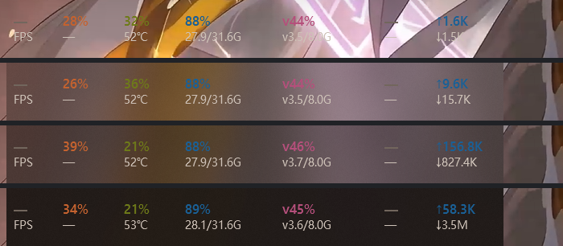
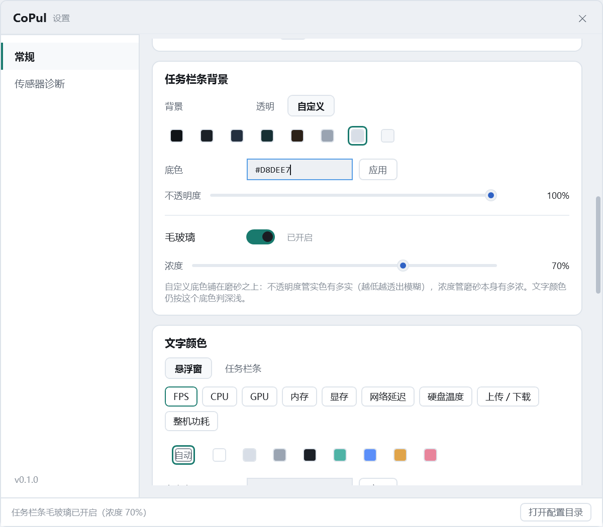

# M4.41 任务栏条加毛玻璃（可开关 + 可调浓度）

## 需求

「再为任务栏添加毛玻璃的效果，可自由开关并调节浓度」

M4.38 把条的「透明」档做成了真·逐像素透明——字直接浮在任务栏上，一个像素的底都不画。
这次要的是另一件事：**允许在条的区域垫一层磨砂**，模糊后面的任务栏，并且浓度可调、可随时关掉。

## 先破一条旧结论：layered 窗口也能吃 accent

代码注释里从 M2 起写着「硬约束：禁止 `AllowsTransparency=true`，它会把窗口切成 layered window，
系统背景直接失效」。M4.38 为了真透明，恰恰把条改成了 layered —— 于是"加玻璃"看起来只剩两条路：
另起一个非 layered 的玻璃宿窗垫在条下面（两窗口 Z 序、位置同步、全屏让路都要重做），
或者把条改回非 layered（真透明会退化成 M4.37 的假透明）。

**先做个决定性实验再动手**：跨进程对运行中的条注入 `ACCENT_ENABLE_ACRYLICBLURBEHIND`，
前后各截一张条区域（`D:\CoPulProbe\accent-test.py`，纯 ctypes，能对任何 HWND 用）：

| | 条内 mean | grad |
| --- | --- | --- |
| 注入前 | (128.1, 108.8, 108.0) | 7.34 |
| 注入半透明红 tint（alpha 0x80） | **(195.2, 140.2, 96.8)** | 4.18 |

条窗口的 `WS_EX_LAYERED` 是实打实开着的（`exstyle=0x80088`），像素还是变了。
**结论：layered 不影响 accent，宿窗方案不必要。** 顺带把这条写回记忆，免得下次又照着老结论去搭窗。

> 教训：这类"DWM 支不支持"的问题，跑一次 30 行的 ctypes 实验比翻十条记忆都省事 ——
> 记忆里的结论往往带着当时的上下文（那次是"非 layered 的客户区 alpha 会被丢掉"，
> 被写成了"layered 不能用系统背景"，因果颠倒了）。

## 改法

### 1. `WindowGlass` 新增两个只注入 accent 的入口

```csharp
public static bool ApplyAccent(Window window, bool dark, double opacity)
public static void ClearAccent(Window window)
```

与已有的 `Apply` 的区别是**不碰窗口本身**：不刷 `Window.Background`、不改 DWM 圆角偏好、
不改 `DWMWA_BORDER_COLOR`。条的形状由它自己的 `Shell.CornerRadius` + 逐像素 alpha 决定，
让 DWM 再插一层 8px 圆角会把四个角啃掉一圈。

`ClearAccent` 复用 `Apply` 里原来那段 `AccentState = 0`（抽成 `DisableAccent`）——
accent 没有生命周期，**"不再调用"不等于"撤掉"**，关掉必须显式下发。

### 2. 开关与浓度是**独立于「背景」两档的一层**，不是第三档

如果做成第三档（透明 / 自定义 / 毛玻璃），"带色的磨砂"就没有表达方式了。
现在两个维度正交，四种组合都成立：

| 背景 | 毛玻璃 | 效果 |
| --- | --- | --- |
| 透明 | 关 | 老样子：什么都不画 |
| 透明 | 开 | **纯磨砂**：模糊 + 浓度着色 |
| 自定义 | 关 | 老样子：半透明实色 |
| 自定义 | 开 | **磨砂上再叠实色**：不透明度越低，模糊越透 |

设置页上的落点（`任务栏条背景` 卡片底部，用分隔线切开）：

- `毛玻璃 [开关]` + `已开启 / 已关闭`
- `浓度 ──○── 70%`（关着时整行置灰，不隐藏 —— 切档时行高不跳）

### 3. 缇的深浅跟字色**反向**

浅色字配深玻璃（`#0F1216`）、深色字配浅玻璃（`#F6F8FB`），RGB 沿用 `TryApplyAccent` 里那一对。
这样调浓度不会把对比度调崩：字是浅色时，玻璃越浓越暗，字反而更清楚。

「文字颜色」里手动锁了一档的话，判定已经体现在 `_inkIsLight` 里，玻璃跟着走。

### 4. 配置与探针

| 键 | 默认 | 含义 |
| --- | --- | --- |
| `TaskbarGlass` | `false` | 毛玻璃开关 |
| `TaskbarGlassOpacity` | `45` | 浓度 0–100 = accent tint 的 alpha |

`TaskbarWindow.SetGlass(on, opacity, persist)` 与 `SetBackdrop` 拆成两个方法：
合成一个的话拖浓度滑块会把底色也重算一遍，自定义档下会连带闪一次实色层。
拖动中 `persist:false`（内存改、盘不写），松手才落盘 —— 与不透明度滑块同一套。

探针：`trayglass:on|off`、`glassopacity:N`（设置页串里按逗号分隔），`bg` 命令多打一行
`taskbarglass: on=… opacity=… switch=… slider=… panelEnabled=… text=…`，
窗口侧的 `BackdropDiag` 末尾多 `glass=on/70%/dark`。

## 验收（Release 0 警告 0 错误）

### 同帧对照：条内 vs 紧邻的任务栏空区

任务栏自己的亚克力一直在动（M4.38 实测同区域连拍差 4 级），**跨时刻差分全作废**，
必须拿同一帧里"条右边那块任务栏"当对照：

| 档 | 条内 mean | 条内 grad | 条外 mean / grad |
| --- | --- | --- | --- |
| 透明 + 关 | (131.7, 138.2, 167.1) | 13.43 | (114.5, 135.9, 150.5) / 30.15 |
| 透明 + **浓度 0** | (114.8, 121.0, 149.4) | **3.74** | 同上 / 30.15 |
| 透明 + 浓度 60 | (59.5, 63.2, 78.0) | 3.66 | 同上 / 30.15 |
| 透明 + 浓度 100 | (25.4, 28.4, 34.9) | 3.64 | 同上 / 30.15 |
| 自定义 40% + 浓度 60 | (47.0, 51.2, 63.0) | 2.31 | 同上 / 30.15 |

**浓度 0 那一行是模糊的铁证**：颜色几乎等于条外（只差亚克力自带的约 17% 基底），
但纹理量从 30.15 掉到 3.74 —— 后面的壁纸被抹平了，这正是"模糊但不着色"。
浓度越高越暗（60% → 59.5、100% → 25.4），单调下降，说明滑块真的在改 tint alpha。

四种浓度自上而下（关 / 30% / 55% / 100%）：



### 设置页

开关在 / 已开启 / 浓度 70% / 提示文案随之变化，状态栏也给了回执：



运行时核对（`--settings-probe "…,trayglass:on,glassopacity:70,bg"`）：

```
taskbarglass: on=True opacity=70 switch=True slider=70 panelEnabled=True text='70%'
taskbarbg: window=backdrop=custom color=#D8DEE7 opacity=100 glass=on/70%/dark shell=#FFD8DEE7 mode=Layered 实色 + Acrylic
```

控件与窗口两侧一致 —— 只看控件不看窗口，正是"改了没反应"那类问题的典型。

## 已知取舍

- **浓度 0 也不是全透**：亚克力自带约 17% 基底色，压不掉（那是它与 `BLURBEHIND` 的本质差别）。
  要真的一点底都没有，就是关掉毛玻璃 + 透明档。
- **浓度 100 = 实色块**，等于把条糊成一块不透明色。滑块不设上限截断，这是用户自己的选择。
- 自定义底 **不透明度 100% + 毛玻璃** 时磨砂完全被实色盖住 —— 设置页的提示文案会明说。
- 托盘右键菜单仍没有入口（与 M4.36 一致，只在设置页；用户没要）。
- 顺手补齐了探针副本的 `runtimes\win-x64`：之前那份缺原生依赖，条上九个字段全是 `—`，
  看着像数据坏了，其实是取证环境不全。

## 回退

`TaskbarGlass` 置 `false` 即回到 M4.38 的行为；`ApplyGlassLayer()` 在关掉时只做
`WindowGlass.ClearAccent(this)`，对渲染路径零影响。
