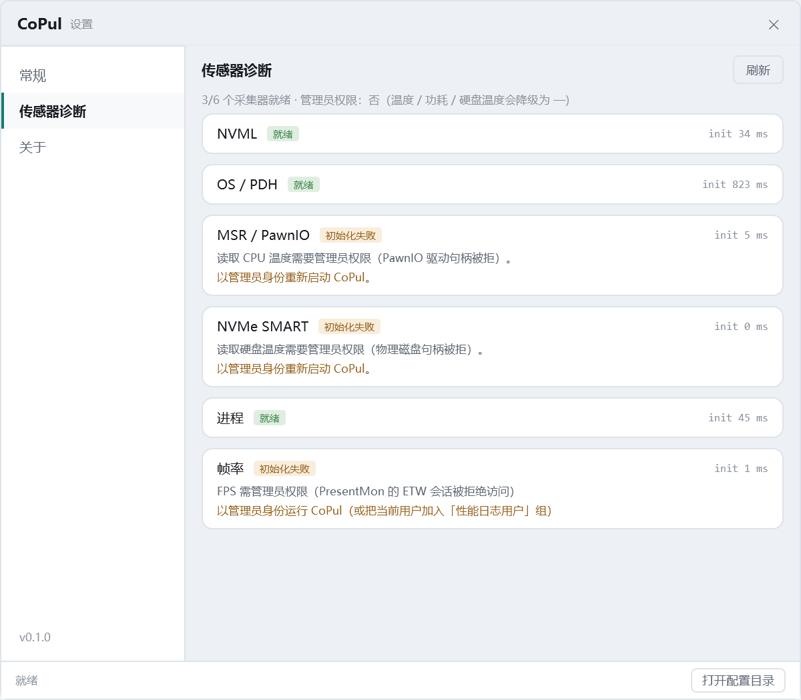

# M4.46 发布打包（绿色 zip + Gitee Release）

> 上线盘点的最后一块：合规齐了（M4.43 同意 / M4.44 关于页 / 许可与组件清单），但仓库里
> 只有"能编译"，没有任何一份**能直接发给用户**的东西。这一版把它固化成一条命令。

## 决策：为什么是绿色 zip，不是安装器

| 形态 | 结论 | 原因 |
| --- | --- | --- |
| **绿色 zip + Gitee Release** | **采用** | 解压即用、不写注册表、不留卸载项；无代码签名时用户对 zip 的戒备低于来路不明的 `.exe` 安装器；与「禁止二次分发」「Gitee Release 免备案」的路线一致 |
| Inno Setup 安装器 | 缓做 | 多一层签名缺失的拦截，还要维护卸载项与安装期 EULA 勾选；等有签名证书再考虑 |
| 单文件 exe | 不做 | 首启要解压到临时目录（慢 2~5 秒）、杀软误报率高；内嵌文件在磁盘上看不见，反而削弱「许可随包可核查」 |

## 脚本做了什么

`tools/publish.ps1`，六步，任何一步失败即退出码 1：

| 步骤 | 内容 | 失败会怎样 |
| --- | --- | --- |
| 1 | 清空上一版产物 | 残留文件会混进新包，而"多一个文件"没人核对 |
| 2 | `dotnet publish -c Release -r win-x64 --self-contained -warnaserror` | 有警告就失败，与"0 警告 0 错误才算过"的约定一致 |
| 3 | 校验 12 项必备文件 | 缺 `libMonoPosixHelper.dll` 之类时程序能启动、一读硬件就崩（M4.41 踩过） |
| 4 | 写 `使用说明.txt` | 拿到 zip 的人只关心「双击哪个、关窗为什么没退、温度为什么是 —」 |
| 5 | 写 `BUILD-INFO.txt`（构建时间 / git 提交 / SDK / 体积 / 许可指引） | 没有它，"用户报的 bug 属于哪一版"只能靠猜 |
| 6 | zip + `.sha256`（`sha256sum` 兼容格式） | 转发途中被替换时无据可查 |

`-NoZip` 可只出目录，调试发布内容时用。

## 产物

| 项 | 值 |
| --- | --- |
| 目录 | `artifacts\CoPul-0.1.0-win-x64\`，483 个文件 / 165.9 MB |
| 压缩包 | `CoPul-0.1.0-win-x64.zip`，69.2 MB |
| 校验 | `CoPul-0.1.0-win-x64.zip.sha256`（大写 SHA-256 + 文件名） |
| 结构 | 解压后是单层 `CoPul-0.1.0-win-x64\`，不是 483 个文件摊一地 |

## 踩到的三个坑

| 坑 | 表现 | 处理 |
| --- | --- | --- |
| **PATH 上的 dotnet 没有 SDK** | `C:\Program Files\dotnet\dotnet.exe` 只装了运行时，直接调它报 `No .NET SDKs were found`，看着像脚本参数写错 | 判据改成"`--list-sdks` 有没有输出"，先试 WorkBuddy 自带 SDK，再试 PATH |
| **`Remove-Item -Recurse` 被安全删除钩子拦成 fail-closed** | 报 `SAFE_DELETE_FAIL_CLOSED`，完全看不出自己错在哪 | 换 `[System.IO.Directory]::Delete()`；删的是脚本自己上一轮的产物，路径可控，不需要回收站 |
| **自包含发布把原生库摊平到根目录** | 校验项写 `runtimes\win-x64\native` 直接误报缺失 —— 那是**框架依赖**发布的布局 | 校验具体文件（`libMonoPosixHelper.dll` / `RAMSPDToolkit-NDD.dll`），不校验目录 |

另外：`Compress-Archive` 的进度条会往 stdout 刷几千行把结论冲掉，脚本里 `$ProgressPreference = "SilentlyContinue"`。

## 补齐的程序集元数据

`CoPul.App.csproj` 新增 `Company` / `Copyright` / `Description` / `RepositoryUrl`。之前 `Copyright` 是空的、`Company` 只是默认取成程序集名 —— 而发布合规红线第 4 条要求「exe 属性、关于页、LICENSE 里的作者信息一致」，用来证明同一性。

## 验收

编译 0 警告 0 错误。

**干净目录实跑**（把 zip 解到 `D:\CoPulReleaseTest`，不是跑开发目录）：

| 检查 | 结果 |
| --- | --- |
| 解压文件数 | 482 → 483（含 `使用说明.txt`） |
| 启动 | 正常；`about: version=0.1.0 (766ec4a)`，图标 `ok`，组件清单 1425 字 |
| 采集器 | 3/6 就绪（NVML / OS·PDH / 进程） |
| 其余 3 项 | MSR·PawnIO、NVMe SMART、帧率 → **普通权限下的预期降级**，诊断页分别写明"需要管理员权限"，与 README 权限表一致 |
| 退出 | `exit code=0`，无残留进程 |

> 这张图的价值在于"它是从 zip 里解出来的那份程序拍的"：如果 `runtimes` 或 `presentmon`
> 漏了，这里会整块变成"初始化失败"，而不是只有权限相关的那三项。

## 还没做的

- **代码签名**：没有证书，SmartScreen 会提示"未知发布者"。已在发布说明里写明核对校验和的办法。
- **上传 Release**：需要作者在 Gitee 网页上手动上传 zip 与 `.sha256`，正文用 `docs/RELEASE-v<版本>.md`（现行 `docs/RELEASE-v0.1.1.md`）。
- **更新检查**：当前版本不联网（这也是隐私承诺的一部分），升级靠用户自行下载新版。
