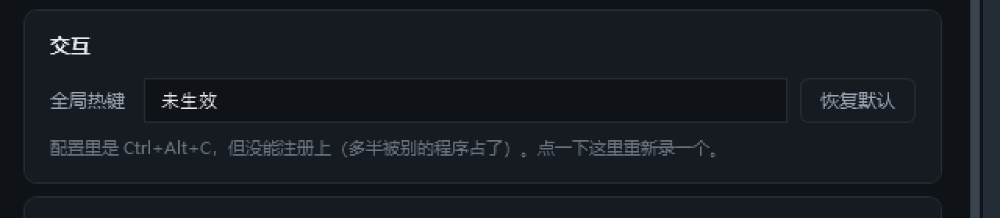
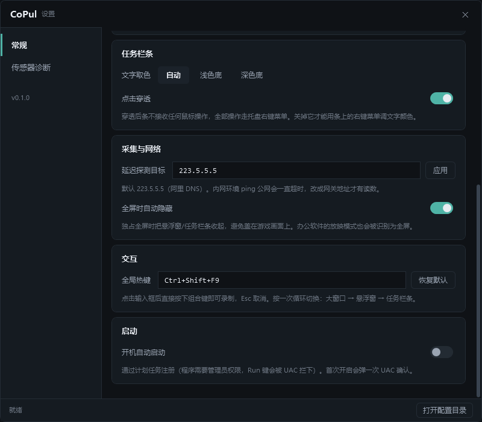

# M4.6 全局热键 阶段报告

- 日期：2026-10-30
- 范围：**G-03 全局热键**（F-12 的第三种切换方式）
- 需求原文：`默认 Ctrl+Alt+C 循环切换模式；可配置；冲突时提示`

---

## 1. 三个组成部分

| 部分 | 文件 | 职责 |
| --- | --- | --- |
| 写法解析 | `Sdk/HotkeyGesture.cs` | `"Ctrl+Alt+C"` ⇄ (修饰键位, 虚拟键码)，纯函数、能报错 |
| 系统注册 | `Interop/Hotkey.cs` | `RegisterHotKey` + 隐藏窗口收 `WM_HOTKEY`，失败回滚 |
| 接线与界面 | `App.xaml.cs` / `SettingsWindow` | 循环切视图、托盘气泡报冲突、设置页录制 |

拆成三层不是为了好看：解析错误（"你写的这个我不认识"）和注册失败（"被别人占了"）
必须能被分开描述，否则用户看到"热键无效"根本不知道该改什么。

### 1.1 必须有一个窗口

热键消息是**投递**给某个窗口的，不是全局钩子。`RegisterHotKey(NULL, ...)` 也能注册，
但消息会落进线程队列、没有窗口过程接住 —— 除非自己跑 `GetMessage` 循环，那会和 WPF 的消息泵打架。

所以建了一个 `0×0` 的隐藏窗口，`ParentWindow = HWND_MESSAGE`：

```csharp
var p = new HwndSourceParameters("CoPulHotkey")
{
    WindowStyle = 0,                    // 不带 WS_VISIBLE
    ExtendedWindowStyle = 0x00000080,   // WS_EX_TOOLWINDOW → 不进 Alt+Tab
    ParentWindow = HwndMessage,         // 消息窗口：连任务栏里都不可能露头
};
```

### 1.2 `MOD_NOREPEAT` 不能省

按住不放时系统每 30ms 发一次 `WM_HOTKEY`，三视图会被连按般地来回切，
松手时停在哪一个是不可预测的。注册时一律带上 `MOD_NOREPEAT`。

### 1.3 循环顺序与状态机

```
大窗口 → 悬浮窗 → 任务栏条 → 大窗口
```

走 `ShowView` 而不是自己 `Show`/`Hide`：全屏状态机的 `CurrentView` 必须同步，
否则下一次全屏判定会按旧视图做决定（"退出全屏没回落"就是这么来的）。
`userInitiated = true`，所以切到悬浮窗会被记成 `manual`，退出全屏不会把它收走。

### 1.4 冲突的三种说法

| 位置 | 什么时候 | 长什么样 |
| --- | --- | --- |
| 托盘气泡 | 启动时注册失败 | 「全局热键不可用：Ctrl+Alt+C 已被其它程序占用」 |
| 设置页输入框 | 打开设置页时 | 框里显示 **未生效**，下方一行写"配置里是 X，但没能注册上" |
| 设置页录制 | 换键时又撞了 | 底栏「没换成：… 已被其它程序占用」，框里回滚成旧值 |

启动时**不阻断**：为了一个快捷键让整个程序起不来是本末倒置。

### 1.5 换键失败要回滚

`Apply()` 会先注销旧键再注册新键。新键失败时如果就这么放着，
用户连试三次都失败就会掉进"越改越没"的陷阱 —— 最后一个能用的组合键也没了。
所以失败路径上会把 `_desired` 恢复成上一个写法并重新注册。

### 1.6 录制期间必须先摘掉自己的热键

热键是全局的。用户在录制框里按下当前组合键时，系统会先把 `WM_HOTKEY` 发给我们 ——
于是视图切走了，输入框什么都收不到。`SuspendHotkey(true)` / `SuspendHotkey(false)`
就是干这件事的。这是所有热键录制框都会踩的坑。

---

## 2. 验证

全部命令都在 `D:\CoPulRun` 下，用 `dotnet.exe CoPul.dll` 启动（apphost 起不来，见前几份报告）。

### 2.1 注册成功

```
23:55:02.221 [fullscreen] start enabled=True view=Taskbar origin=Manual polling=True
23:55:02.237 [hotkey] apply "Ctrl+Alt+C" ok
```

### 2.2 系统热键表里确实有这个键

比"看日志说 ok"更硬的一条：另起一个进程去抢注同一组合键。

```
Ctrl+Alt+C : 抢注成功=False err=1409     ← ERROR_HOTKEY_ALREADY_REGISTERED
Ctrl+Alt+F9: 抢注成功=True
```

第二个组合键能抢到，说明不是"整类热键被系统禁掉"，而是 `Ctrl+Alt+C` 这一个确实被占了。

### 2.3 循环切换

`--hotkey-fire 3` 往自己的隐藏窗口投三次 `WM_HOTKEY`（走同一个 Hook 与 `Pressed`）：

```
23:53:40.368 [hotkey] probe fire 第 1 次，按前 view=Taskbar
23:53:40.918 [view] Taskbar→Main by=hotkey user=True
23:53:41.537 [view] Main→Float by=hotkey user=True
23:53:42.418 [view] Float→Taskbar by=hotkey user=True
23:53:43.369 [hotkey] probe fire 结束 view=Taskbar
```

三次回到原点，顺序与设计一致。

### 2.4 写法错误

```
apply "Ctrl+Q+Z" 失败：「Ctrl+Q+Z」里出现了两个主键；已回滚到 Ctrl+Alt+C
apply "F9"       失败：至少需要一个修饰键（Ctrl / Alt / Shift / Win）；已回滚到 Ctrl+Alt+C
```

### 2.5 冲突

先用一个 Python 进程占住 `Ctrl+Alt+C`，再启动 CoPul：

```
23:54:34.630 [hotkey] apply "Ctrl+Alt+C" 失败：Ctrl+Alt+C 已被其它程序占用；已回滚到 (无)
23:54:34.632 [tray] balloon ok=True title="CoPul 芯脉"
```

设置页此时显示：



### 2.6 设置页改键 / 录制

```
--settings-probe "hotkey:Ctrl+Shift+F9"      → apply "Ctrl+Shift+F9" ok，配置落盘
--settings-probe "capture:ctrl+alt+F9"       → suspend → apply "Ctrl+Alt+F9" ok，配置落盘
```

落盘值（`%APPDATA%\CoPul\config.json`）：

```json
"Hotkey": "Ctrl+Alt+F9"
```

### 2.7 设置页外观



---

## 3. 本轮踩到的坑

### 3.1 `SendInput` 在本机环境里到不了输入队列

想用"真发一次 `Ctrl+Alt+C`"做端到端验收，结果 `SendInput` 返回 6（六个事件都发出去了），
CoPul 一条 `WM_HOTKEY` 都没收到。

排查顺序：

1. 怀疑结构体大小 —— x64 上 `INPUT` 是 **40** 字节（联合体取 `MOUSEINPUT` 的 32），
   只放 `KEYBDINPUT`（24）会算出 32，`SendInput` 直接返回 0。补齐后确实从 0 变成 6。**这是真 bug，已修**。
2. 结构对了还不来，就做对照实验：**纯 Python 自己注册同一个热键、自己收消息**，同样收不到。

所以这是环境限制（注入的按键进不了当前输入桌面），不是 CoPul 的问题。
结论：热键这条路拆成两半分别验 —— 注册用"别人抢不到"验（2.2），
按下之后做什么用 `WM_HOTKEY` 直接投递验（2.3）。

### 3.2 `--shot` 属测量模式，热键原本被跳过

第一版把热键和托盘一起挂在 `!measurementMode` 下面，于是 `--settings --shot` 截出来的图里
热键栏永远显示"未生效" —— 截图骗自己。改成只在 `--view-probe` 下跳过。
`--shot` / `--stats` 照样注册：一次 `RegisterHotKey` 的开销可以忽略，而截图要能反映真实状态。

### 3.3 事件不能从外部赋值

`public event Action? Pressed;` 在 App 里写 `hotkey.Pressed = ...` 会报 CS0070。
改成委托属性（与 `TrayIcon.LeftClick` 一致）：订阅方只有一个，用 event 反而暗示"可能有多个"。

---

## 4. 已知限制

- **物理按键没能自动验收**（3.1）。注册是真的（别人抢不到），消息处理是真的（投递即切视图），
  中间"系统把物理按键匹配到已注册热键"这一环没能在本机造出来。
- 不支持单独一个键（如 `F9`）作为热键：会独占整台机器的那个键，连在记事本里打字都会被吞。
- `F12` 被系统保留给调试器，注册必然失败，解析阶段就拦下并提示换键。
- 热键生效范围是全系统，包括 CoPul 自己在前台的时候。录制框靠"先摘掉"绕开了这个冲突，
  但其余场合（比如设置页的别的输入框里按到）仍会切视图 —— 与需求一致，未做特殊处理。
