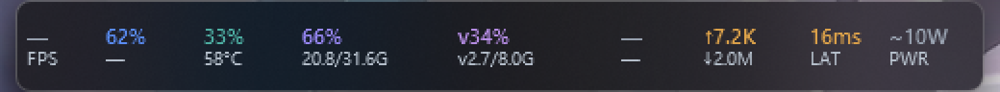
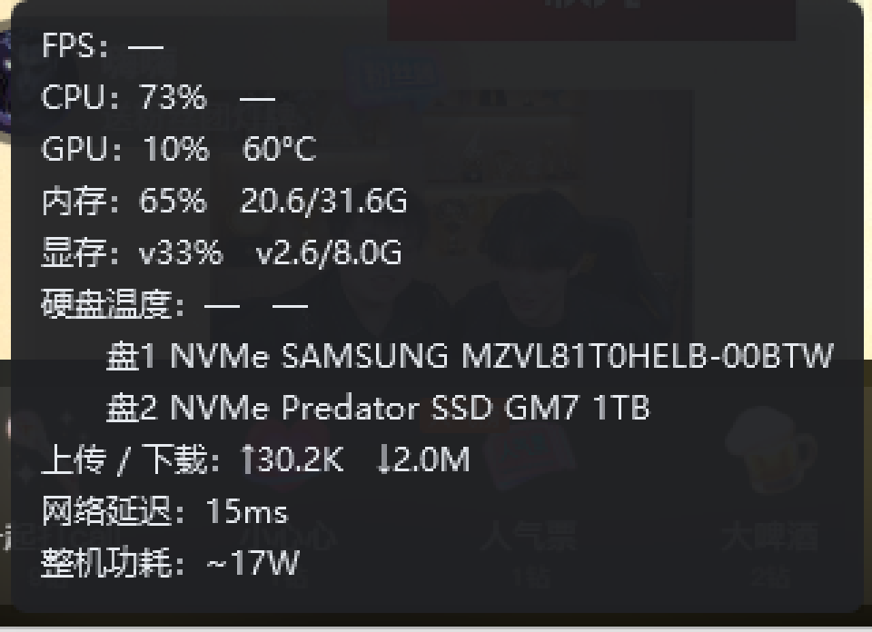

# M4.7 任务栏显存字段 阶段报告

- 日期：2026-10-31
- 范围：**7.4 字段表补入显存**，位置在「内存」之后
- 用户原话：`任务栏模式中没有显存的占用，将显存的占用放到内存占用后面`

---

## 1. 问题在哪

任务栏条的字段表（`Sdk/TrayFields.cs`）是从需求 7.4 的八项抄下来的，而那八项里**没有 VRAM**；
悬浮窗（6.3 六格）有大窗口也有（`GpuMem`），只有任务栏这条路径漏了。

数据本身一直在采：`NVML` 的 G03/G04（显存占用率、使用/总量）走 T0 轻量组，
100ms 一次，`FloatVram` 这个 `FloatField` 早就存在、只是没接到条上。
所以这次是**纯接线**，不新增任何采集。

## 2. 改动

| 文件 | 改动 |
| --- | --- |
| `Sdk/TrayFields.cs` | `Keys` / `Labels` 在 `ram` 后插入 `vram`；`AutoDropOrder` 同步插入 |
| `TaskbarWindow.xaml` | `RamCell` 后新增 `VramCell`；右键菜单新增「显存」勾选项 |
| `TaskbarWindow.xaml.cs` | `AllFields`、`_cells`、`_fieldMenuItems` 三张表各补一条 |
| `Sdk/DashboardState.cs` / `ConfigStore.cs` / `SettingsWindow.xaml.cs` | 只改注释里的「八」→「九」 |

设置页的勾选框和托盘菜单的字段子菜单都是**按 `TrayFields.Keys` 循环生成**的，
一行代码都不用动就多出了「显存」—— 这正是 M4.2 把字段表抽出来的收益。

### 2.1 为什么排在内存后面

用户点名了位置，按原话放。视觉上也最合理：内存 `66% / 20.8/31.6G` 与显存
`v34% / v2.7/8.0G` 上下相邻，两行都带小写 `v`（6.3 / Q-04 的约定），
扫一眼就能对比「系统内存吃了多少、显卡显存吃了多少」。

### 2.2 让位优先级：显存排在内存**之后**才砍

7.7 的临时让位顺序原来是 `pwr → lat → io → disk → ram → gpu → cpu`。
显存插在 `ram` 与 `gpu` 之间：

```
pwr → lat → io → disk → ram → vram → gpu → cpu
```

理由是用户主动要这个字段，空间不够时不该比内存先消失；但它又确实比
CPU/GPU 占用率次要（GPU 那格已经有占用率和温度了）。

## 3. 验收

### 3.1 条上九格（`--tray --shot-screen --tray-raise`）



```
place: bar=(0,1552)-(2560,1600) edge=Bottom free=861 need=504 used=504
       scale=1.00 autohide=False fields=9/9 dropped=[]
```

- `fields=9/9`：九格全部画出来了，没有被 7.7 挤掉
- `need=504` 与 `used=504`：窗口宽度正好等于内容需求，右侧没有留白
- 满九格宽 504 px（100% 缩放）：`34+44+44+74+78+36+48+34+44 = 436` + 间距 `7×8 = 56` + 内边距 `12`
- 本机任务栏左侧空白 `free=861`，加完显存后余量仍有 357 px

### 3.2 字段开关真的能关也能开

走 `--tray-menu-probe field:vram`（与托盘菜单、条右键菜单同一份 `switch`）：

```
关 → fields=8/9 need=419     配置 TaskbarHiddenFields = ["vram"]
开 → fields=9/9 need=504     配置 TaskbarHiddenFields = []
```

504 − 419 = **85**，正好是显存格宽 78 + 组间距 7 —— 说明关掉后宽度真的回收了，
不是留了一段空位（7.4 / Q-03 的要求）。

### 3.3 窄空间下的让位顺序（`--tray-free 200`，只伪造输入）

```
place: free=200 need=148 used=148 fields=3/9
       dropped=[pwr,lat,io,disk,ram,vram]
```

按预期先砍到内存、再砍显存，最后留下 `fps/cpu/gpu` 三格。
换回真实空白（861）后自动长回九格，配置没被写脏。

### 3.4 悬停提示跟着多了一行（7.6）



```
FPS：—
CPU：73%   —
GPU：10%   60°C
内存：65%   20.6/31.6G
显存：v33%   v2.6/8.0G      ← 新增
硬盘温度：—   —   （下面两行盘型号）
上传 / 下载：↑30.2K  ↓2.0M
网络延迟：15ms
整机功耗：~17W
```

提示文本不是重新格式化的，而是直接读条上那两个 `FloatField` 字符串
（`BuildTooltipText` 用 `TrayFields.Labels[i]` 与 `_cells[i]` 索引对齐），
所以不会出现「条上 33%、提示里 34%」。加字段时**只要三张表顺序一致**就自动对上。

### 3.5 设置页


「任务栏字段」组自动变成九个勾选框，显存紧跟内存、默认勾选。
配置里 `TaskbarHiddenFields` 为空 → 新字段默认可见，不需要写迁移。

## 4. 已知限制

- **占宽 +85 DIP**（78 + 间距）。100% 缩放下本机余量充足；空白紧张时
  7.7 会按新顺序临时让位，不会把条撑出可用区。
- **非 NVIDIA 平台**显存仍是 `v—`：DXGI 只给容量不给用量（A-08 / A-11 的既有边界），
  与悬浮窗表现一致，不是本项引入的。

## 5. 结论

需求 7.4 的字段表实际是九项，之前漏了显存。现在条上顺序为

```
FPS · CPU · GPU · 内存 · 显存 · 硬盘温度 · 上传/下载 · 网络延迟 · 整机功耗
```

纯接线改动，未新增采集、未改布局算法；`build -c Release` 0 警告 0 错误。
