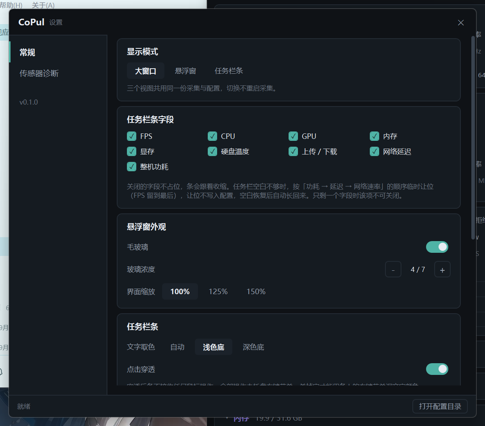

# M4.8 设置页窗口圆角 阶段报告

- 日期：2026-10-31
- 范围：设置页（G-08）窗口四角，与主窗口保持同一套做法
- 用户原话：`设置界面也弄一下圆角`

---

## 1. 为什么本来是方的

设置页 XAML 里其实一直写着圆角：

```xml
<Border BorderBrush="{StaticResource BrushStroke}" BorderThickness="1"
        Background="{StaticResource BrushBg}" CornerRadius="8">
```

但 `<Window Background="{StaticResource BrushBg}">` 是**不透明**的，它铺满整个客户区矩形 ——
四角那两块底色把 Border 画出来的圆角盖住了，屏幕上看到的仍然是方窗口。
主窗口不是这样，因为它早在 `OnSourceInitialized` 里让 DWM 裁了圆角，设置页漏了这一步。

## 2. 改动

`SettingsWindow.xaml.cs` 新增「窗口外观」段，与 `MainWindow.xaml.cs` 同一套：

| 路径 | 条件 | 做法 |
| --- | --- | --- |
| Win11 22000+ | `DWMWA_WINDOW_CORNER_PREFERENCE = DWMWCP_ROUND` 返回 S_OK | DWM 按当前 DPI 裁切 + 抗锯齿，最大化时自动恢复直角 |
| Win10 及更早 | 属性不被识别 | `SetWindowRgn` 裁圆角矩形，`SizeChanged` / `StateChanged` 维持 |

```csharp
_dwmRoundCorners = Win32Window.TryEnableDwmRoundCorners(_hwnd);
Interop.Trace.Log("settings", $"round: dwm={_dwmRoundCorners} hwnd=0x{_hwnd:X}");

if (!_dwmRoundCorners)
{
    ApplyRoundRegion();
    SizeChanged += (_, _) => ApplyRoundRegion();
}
```

半径 8 DIP，与 XAML 里 Border 的 `CornerRadius="8"` 严格一致 —— 不一致会让描边在
弧线处露出一个角（主窗口的 `CornerRadiusDip` 注释写过这条）。

### 2.1 顺手给 XAML 加了条注释

`WindowChrome.CornerRadius` 保持 `"0"`，并写明原因：那个属性只在 Win8/8.1 生效，
Win10/11 上写任何非 0 值都不会有反应。不留注释的话，下一个人会以为"改这里就能圆角"。

## 3. 验收

**必须用屏幕抓取，不能用 `--shot`。** `--shot` 走 `RenderTargetBitmap`，
它只画 WPF 自己的视觉树 —— `Window.Background` 那个不透明矩形在 RTB 里就是方的，
拍出来永远是直角，会给出"没生效"的假象（反过来也一样：只要 XAML 有 Border 圆角，
RTB 就能拍出圆角，哪怕窗口本身是方的）。圆角是 DWM 在合成阶段裁的，只能 `--shot-screen`。

```
--settings --shot-screen ... --shot-pad 14 --wait 5000
```

日志：

```
00:16:42.797 [settings] round: dwm=True hwnd=0x21117C
```



四角放大（裁剪自同一张截图，8×）：

| 左上角 | 右下角 |
| --- | --- |
|  |  |

- 左上角弧线平滑、无明显锯齿（DWM 自己做抗锯齿），圆角外侧透出的是**背后的网页**，
  说明四角确实被裁掉而不是画了个深色圆环
- 右下角同样成弧，外侧是当时的桌面内容
- 当前显示缩放 **150%**（窗口 800×700 DIP → 1200×1050 物理像素），
  DWM 按 DPI 自动放大了半径，不需要我们再换算

## 4. 已知限制

- **Win10 的 Region 兜底本机测不到**：这台是 Win11 26200，代码走的是 DWM 分支。
  Region 路径与主窗口是同一份 `Win32Window.ApplyRoundRegion`，M2 在主窗口上验过
  （1 位掩码、无抗锯齿）。
- 圆角处的 6 DIP 调整大小热区仍在矩形的角上，圆形缺口那一点点点不到 ——
  系统原生窗口也是这样，不处理。
- 最大化后 DWM 自动切成直角，无需额外判断；Region 路径则由 `StateChanged` 显式恢复矩形。

## 5. 结论

设置页现在与主窗口、悬浮窗一样是圆角窗口，半径 8 DIP，`build -c Release` 0 警告 0 错误。
