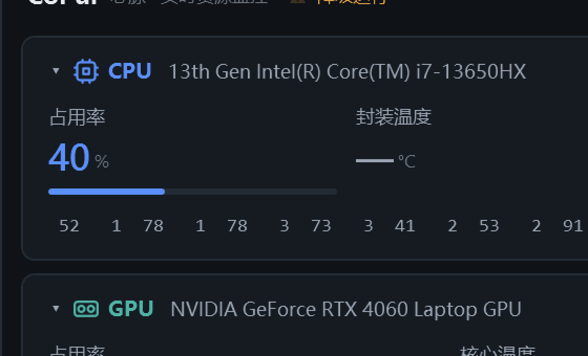
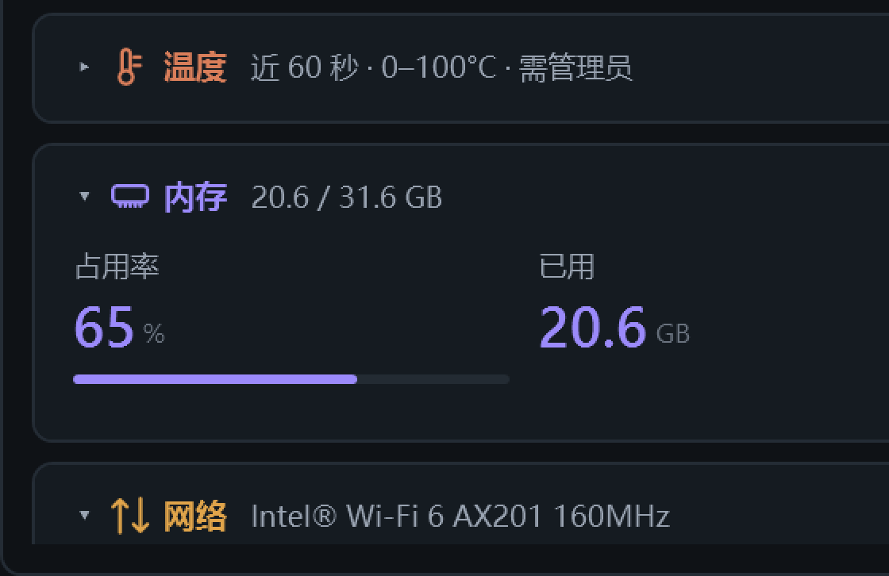
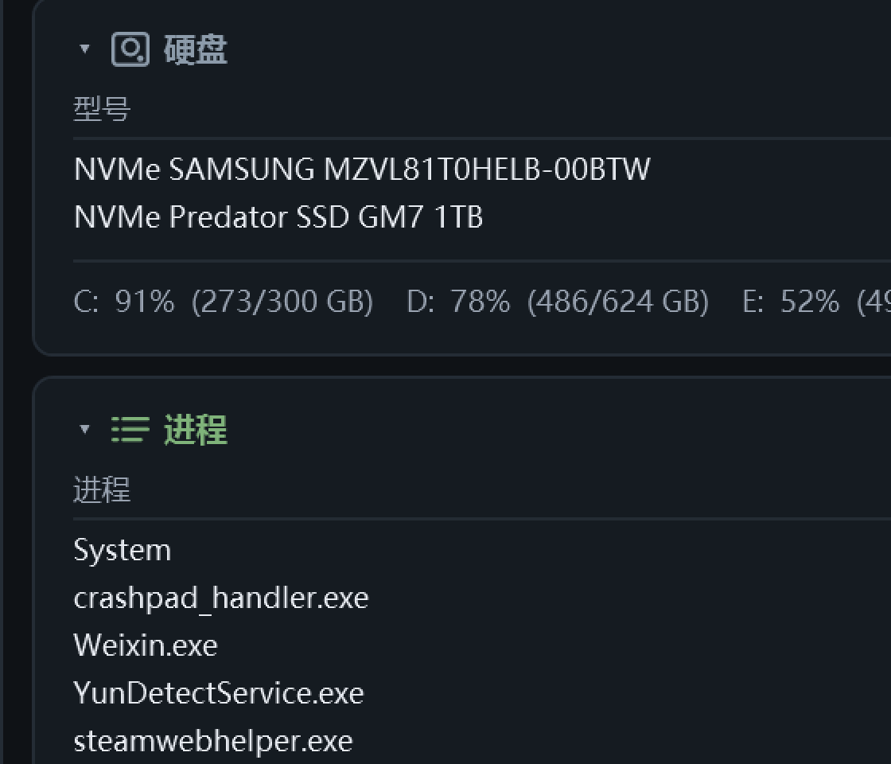
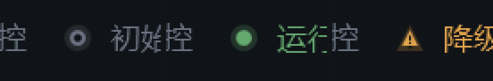

# M4.9 指标图标与状态灯形状 阶段报告

- 日期：2026-10-31
- 范围：R-04 指标图标组、R-05 状态图标组（顶部运行状态灯）
- 用户原话：`可以会这样改`（对上一轮样张与放置方案的确认）

---

## 1. 背景

界面上原本一个图标都没有：九个区块标题前面只有折叠箭头 + 文字，顶部运行状态灯是一个
10px 的纯色圆点。后者是 R-05 的唯一违例点 ——

> R-05｜状态图标组（3 枚）｜16×16：正常/警告/危险 ｜ 圆形/三角形/圆形带叹号；
> **形状也要区分，不能只靠颜色（色盲）**

纯色圆点靠绿/黄区分状态，色盲用户等于看不出区别。这次一并改掉。

## 2. 做了什么

### 2.1 R-04：九枚区块图标

`Themes/Icons.xaml`（新增）定义九枚 Geometry，`Themes/Styles.xaml` 不变，样式也放在
Icons 里的 `BlockIcon`（16 DIP、1.5 描边、圆角线帽），各区块只负责给 `Stroke`：

| 区块 | 几何 | 着色 |
| --- | --- | --- |
| CPU | 芯片（外框 + 内核 + 八引脚） | `AccentCpu` |
| GPU | 显卡（卡体 + 双风扇） | `AccentGpu` |
| FPS | 画框 + 播放三角 | `AccentFps` |
| 趋势 | 折线 | `AccentCpu` |
| 温度 | 温度计（管 + 球 + 两道刻度） | `AccentPower` |
| 内存 | 内存条（条体 + 五根金手指） | `AccentRam` |
| 网络 | 上下双箭头 | `AccentNet` |
| 硬盘 | 盘体 + 盘片 + 指示灯 | `AccentDisk` |
| 进程 | 三行列表 | `AccentFps` |

图标插在折叠箭头与标题字之间（`Margin="0,0,6,0"`），行高不变。

### 2.2 R-05：状态灯改成「形状 + 颜色」

三态形状（`Icons.xaml` 里的 `ShapeState*`，包络盒统一归一到 21.6×21.6，
保证三种形状显示出来视觉大小一致，不会"降级时灯突然变小"）：

| 运行状态 | 形状 | 颜色 |
| --- | --- | --- |
| 初始化 | 空心圆环 | `BrushTextTertiary` |
| 运行中 | 实心圆 | `BrushOk` |
| 降级运行 | 三角（内嵌感叹号缺口） | `BrushWarn` |

光晕与内芯共用同一份几何（放大 1.67 倍，对应原来 10px 晕 / 6px 芯），
所以三角态的晕也是三角，不会再套一个圆底。

形状由 `DashboardState.RunStateShapeKey`（`"starting"` / `"running"` / `"degraded"`）
驱动 XAML 的 `DataTrigger` 切换 `Path.Data`。**刻意不复用 `RunStateText`** ——
文案随时会改，形状不能跟着文案一起静默失效。

### 2.3 两处偏离需求字面，需要记一笔

**(1) R-04 列了 10 枚，只做了 9 枚。** 缺的三枚是 VRAM / PWR / FAN：显存和功耗是 GPU/CPU
卡片内部的小格子（`MetricTile`），格内标题本来就小，再塞图标会杂碎；风扇那枚更没地方 ——
R26 已经把"风扇"格从 GPU 卡片删掉（移动版 NVML 不提供转速）。做了却没有使用位置，
只会变成要跟着主题维护的死资源。**以后悬浮窗/任务栏真的要图标时再补。**

**(2) 产物是 Geometry 资源，不是 R-04 要求的 `.svg` + 多尺寸 `.png`。** 理由是 R-04 同一行
还写着「单色，仅描边不填充；必须与文字色同步」：位图做不到运行时换色，要同步就得给每种
语义色各出一套图，主题维护量直接乘 8；`Path` 的 `Stroke` 直接吃绑定，一块几何能同时被
CPU / GPU / 内存分别染成各自的颜色。几何按 10.5 的规格画在 **24×24 画布、1.5 描边、圆角线帽**，
显示时缩到 16 DIP（24→16 是 2/3，1.5 描边落到 1.0 DIP，150% 缩放下是 1.5 物理像素）。

## 3. 验收

真实运行、`--shot`（RenderTargetBitmap）取证，150% 缩放。

### 3.1 图标（CPU / GPU / FPS）

### 3.2 图标（温度 / 内存 / 网络）

温度计、内存条、双箭头在 16 DIP 下都能认出来；内存条的五根金手指没有糊成一块。

### 3.3 图标（硬盘 / 进程）

### 3.4 状态灯三态（左 → 右：初始化 / 运行中 / 降级运行）

三张分别是 `--run-state-probe starting|running|degraded` 强制出来的。
圆环、实心圆、三角感叹号三者形状差异一眼可辨，颜色仍然保留 —— 色盲用户看形状，
正常用户看颜色，两条通道各自成立。

## 4. 为验收加的两个探针

这两枚都不是生产路径，只在 `--shot` 分支里生效，**不影响正常运行**：

| 开关 | 作用 | 为什么非加不可 |
| --- | --- | --- |
| `--shot-scroll <DIP>` | 截屏前把内容区滚到指定偏移 | 一屏放不下九个区块，硬盘/进程的标题在最下面；RTB 只画可视区，不滚永远拍不到。不能靠"把窗口拉高"代替 —— 那会连带改变换行与列宽，拍出来的不是真实布局 |
| `--run-state-probe starting\|running\|degraded` | 强制顶部状态灯三态 | 本机没提权，正常跑起来永远是「降级运行」，实心圆与空心圆环平时拍不到 |

顺带给 `SavePng` 加了 `window.UpdateLayout()`：刚改过绑定（换灯的形状）时只标了脏，
不重新排版的话 RTB 画出来还是改之前的样子。

## 5. 已知限制

- 图标描边实际渲染是 **1.0 DIP**（24 画布缩到 16 的结果），比 10.5 写的 1.5 细。
  这是"几何按 24 画、显示按 16"的必然结果，与 Feather/Lucide 这类 24 网格图标集一致。
  若后续觉得偏细，把 `BlockIcon` 的 `StrokeThickness` 调到 2.0（渲染 1.33）即可，一处生效。
- 100% 缩放下 1.0 DIP 描边可能落在半像素上、略显发灰；150% 缩放下是 1.5 物理像素，正好像素对齐。
  本次验收在 150% 下完成，100% 未逐枚细看。
- Win10 上无差异（本项不涉及 DWM，纯 WPF 绘制）。

## 6. 改动文件

| 文件 | 状态 | 内容 |
| --- | --- | --- |
| `src/CoPul.App/Themes/Icons.xaml` | 新增 | 九枚区块图标 Geometry + 三枚状态形状 + `BlockIcon` / `RunStateShape` 样式 |
| `src/CoPul.App/App.xaml` | 改 | 合并 `Themes/Icons.xaml` |
| `src/CoPul.App/MainWindow.xaml` | 改 | 九个区块标题插入 `<Path>`；状态灯由两个 Ellipse 换成两个 Path |
| `src/CoPul.App/MainWindow.xaml.cs` | 改 | `ScrollContent()`（`--shot-scroll` 用） |
| `src/CoPul.App/Sdk/DashboardState.cs` | 改 | `RunStateShapeKey` + 变更通知；`ForceRunState()`（探针用） |
| `src/CoPul.App/App.xaml.cs` | 改 | `--shot-scroll` / `--run-state-probe` 接线；`SavePng` 前 `UpdateLayout()` |

编译：`Release` 配置 0 警告 0 错误。
